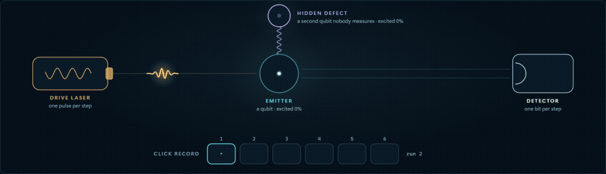
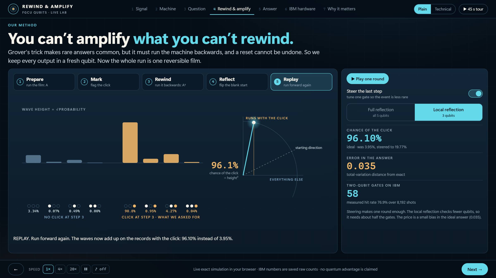
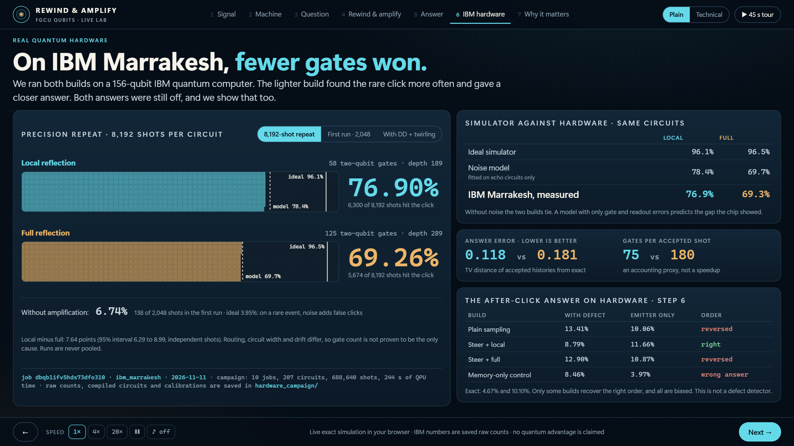
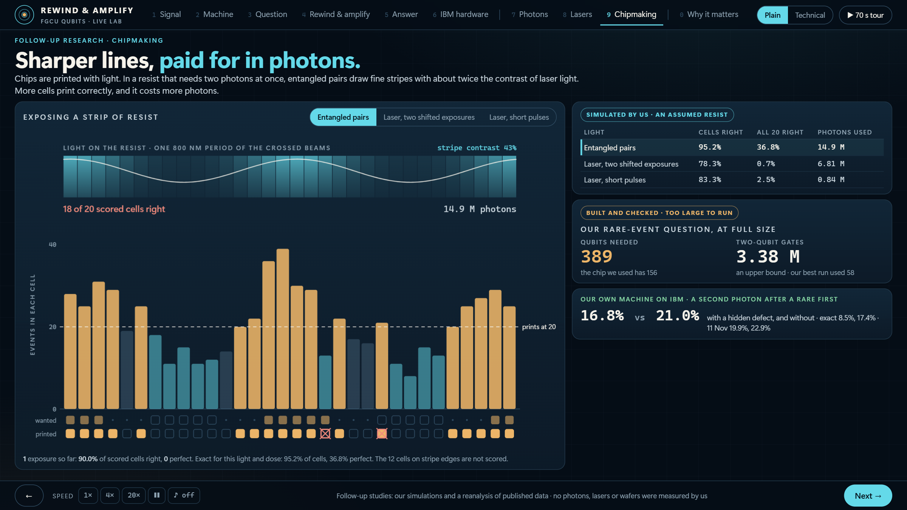
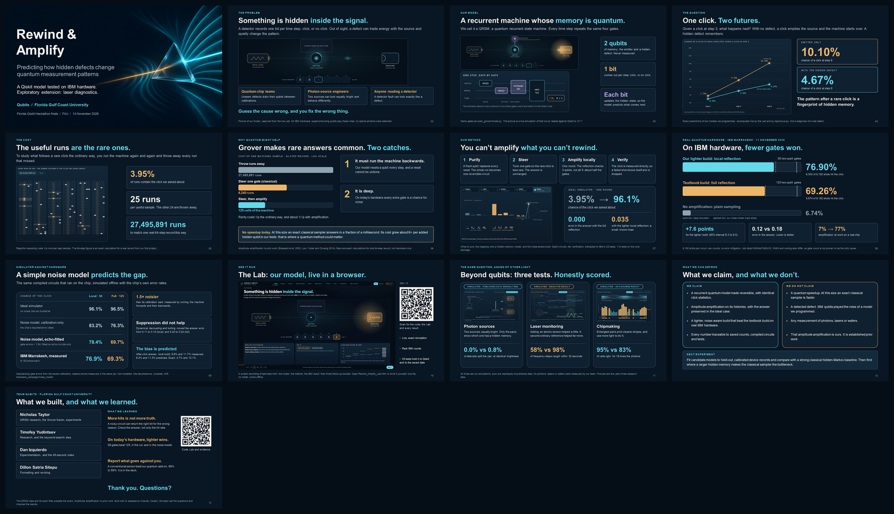

# Rewind & Amplify

**Asking a quantum model about its rarest events, and checking the answer on IBM hardware.**

FGCU **Qubits** · IBM Qiskit Fall Fest 2026 · Florida finals, 14 November 2026 · V3

[](https://github.com/Nicholas55555/rewindandamplifyv3/actions/workflows/ci.yml)

**[Open the Lab](https://nicholas55555.github.io/rewindandamplifyv3/) · [Slides](finals-deck/Rewind_Amplify_Finals_V3.pdf) · [70-second tour](media/lab-tour.mp4) · [Reproduce it](#try-it) · [Evidence map](docs/EVIDENCE.md) · [For judges](#for-judges-where-each-criterion-is-answered)**



*A live, exact simulation of our model, recorded from [the Lab](Rewind_Amplify_Lab.html). Watch a click: the emitter empties, and the hidden defect keeps what it had.*

## The problem

A detector records one bit per time step: click, or no click. That record is all anyone sees. Out of sight, a defect can trade energy with the source and quietly change the pattern.

Teams building quantum chips have this problem: hidden two-level defects drain their qubits between calibrations. So do engineers building single-photon sources. And it is easy to get wrong, because a faulty detector can look exactly like a defect. Guess the cause wrong, and you fix the wrong thing.

## The idea in a minute

We model the device as a **quantum recurrent state machine (QRSM)**: a small circuit that behaves like a recurrent network whose memory is qubits. Two qubits hold the memory and are never measured. One bit comes out per step.

The useful question is about a rare event: **given a click at step 3, what happens next?** With no defect, a click empties the source and the machine starts over, so the chance of another click at step 6 is **10.10%**. With a hidden defect, something remembers, and it is **4.67%**. The pattern after a rare click is a fingerprint of hidden memory.

The catch is the cost. That click happens in 3.95% of runs, so the ordinary method runs the machine 25 times and throws 24 away. For one real 64-step record it would take 27,495,891 runs.

Grover's algorithm, in its general form called amplitude amplification, makes rare answers common at about the square root of the cost. But it has to run the machine backwards, and our machine resets a qubit every step. A reset cannot be undone. **You can't amplify what you can't rewind.** So we built it in four moves:

| Move | What it does | What it buys |
|---|---|---|
| **1. Purify** | A fresh qubit replaces every reset | One reversible circuit with identical click statistics |
| **2. Steer** | Tune one gate so the rare click is less rare | Less rarity for free; the answer is unchanged |
| **3. Amplify locally** | One round, with a reflection on 3 qubits instead of all 5 | About half the gates, so less noise |
| **4. Verify** | The click is measured directly | A failed shot shows itself and is dropped |



## What we found

Everything below is recomputed by `python reproduce.py` or recounted from saved raw counts.

| | Our lighter build (local reflection) | Textbook build (full reflection) |
|---|---:|---:|
| Two-qubit gates after compiling for IBM Marrakesh | **58** | 125 |
| Chance of the click, ideal simulator | 96.10% | 96.49% |
| Chance of the click, our noise model | 78.40% | 69.72% |
| **Chance of the click, measured on IBM Marrakesh** | **76.90%** (6,300 of 8,192) | **69.26%** (5,674 of 8,192) |
| Error in the answer, measured (lower is better) | **0.118** | 0.181 |

Without amplification the same chip returned the click in 6.74% of shots.

- **It works exactly in simulation.** Qiskit circuits match the exact model to better than 10⁻¹⁴, and full amplification leaves the conditional answer untouched.
- **On real hardware, fewer gates won.** The lighter build led by 7.6 points (95% interval 6.3 to 9.0) in the 8,192-shot run, and led in all three runs that day.
- **A simple noise model predicts the gap.** With no noise the two builds tie. A model with only gate and readout errors, with one scale factor fitted on separate echo circuits, predicts 78.4% and 69.7%. The chip gave 76.9% and 69.3%. [Details](hardware_campaign/noise_model/README.md).
- **Error suppression did not help.** Dynamical decoupling and twirling on the identical circuits made the answer error worse.
- **The answers on hardware are biased, and we show it.** The lighter build returned 8.79% and 11.66% for the two futures, against the exact 4.67% and 10.10%: the right order, visibly off. The noise model predicts that bias within half a point.
- **Plain sampling got an answer backwards; rewinding got it right, twice.** Asked how often a second click follows a rare first one, plain sampling on IBM put the two machines in the wrong order in both of our runs. The rewound circuits put them in the right order in both. The second run's answers were predicted before it ran. [Details](applied/README.md).



## The same question, asked of other light

The follow-up studies asked whether the idea reaches beyond qubits: to photon sources, laser monitoring and chipmaking. Each is a tab in the Lab. Each is a simulation or a reanalysis of published data, not a measurement of ours, and one of them went against us.

| Lab tab | What you watch | What we found | Kind of evidence |
|---|---|---|---|
| **Photons** | Two photons from one source meet at a beam splitter, while a hidden environment may change between them | Two sources of identical brightness split 0.0% and 0.8% of attempts: only the pairs tell them apart. Photons from a real GaAs quantum dot interfere with visibility 0.77 to 0.83. | Simulated by us; data published by Münzberg et al. (2022), reanalysed |
| **Lasers** | A laser's frequency steps at an unknown moment, and three monitors have 32 seconds to catch it | An ordinary reference caught 51% of steps. Adding an atomic sensor: 58%. A second ordinary reference: 98%. | Simulated by us. A negative result for the quantum add-on, kept. |
| **Chipmaking** | Light prints fine stripes on a resist that needs two photons at once, cell by cell | Entangled pairs print 95% of cells correctly and the best laser route 83%, for 18 times the photons. Our rare-event question at full size needs 389 qubits; the chip has 156. | Simulated by us with an assumed resist. The 389-qubit circuit was built and checked, not run. |



### And asked back of our own machine, on IBM hardware

Those three studies use models of their own. To tie them to the method, we asked **our** machine, the emitter with one hidden defect, the question the three fields share: *after a rare event, was it a one-off, or is something hidden remembering?* It ran twice on IBM Marrakesh, and the second run's answers were written down before it ran. Each research tab in the Lab carries its line of this table in green. [Full write-up](applied/README.md).

| Field | The question, in our machine | Exact | IBM, rewound: 12 Nov · 11 Nov | IBM, plain sampling |
|---|---|---:|---:|---:|
| **Chipmaking** | A two-photon resist prints on pairs. After a rare first photon, how often does a second follow: with a hidden defect, and without? | 8.5% vs 17.4% | **16.8% vs 21.0%** · 19.9% vs 22.9% | 47.3% vs 34.2% · 38.6% vs 25.7% |
| **Lasers** | The same reading, before and after the hidden defect's frequency steps | 8.5% → 14.2% | **16.8% → 21.0%** | 47.3% → 45.0% |
| **Photons** | g⁽²⁾ right after a photon: with a hidden defect, and without | 0.24 vs 0.13 | **0.54 vs 0.32** · 0.44 vs 0.35 | needs both circuits |
| **All three** | How often the hidden defect holds the energy at the moment of the rare event (29% at a typical moment) | 8.5% | **17.2%** · 15.9% | 24.7% · 24.6% |

- **Plain sampling got the chip answer backwards, twice.** The rare click is 4% of runs and the device adds false clicks at about that rate, so half or more of the "rare events" it keeps are noise. Rewinding makes the click three shots in four, and the order comes out right in both runs, with a third to a half of the true gap.
- **The frequency step was seen on hardware,** at +4.2 points against a true +5.8. We had predicted +3.7 before the job ran. Every predicted direction held, and three of five predicted sizes were inside the measured intervals.
- **One reading did not repeat.** Three steps after a click, g⁽²⁾ told the two machines apart on 11 November and not on 12 November.
- **A smaller chipmaking toy, 13 November.** A hidden dose, a contact that rarely fails to print, and its neighbour, on four qubits: [`applied/contact/`](applied/contact/). All four directions stated before the job held; four of twelve predicted sizes did. It is solved by hand, and with its own check bit as a filter plain sampling does nearly as well. It is not in the talk.
- **What this is not.** The machine is a toy that a classical filter solves exactly. Rewinding runs a model inside a quantum computer: it cannot rewind a real laser, quantum dot or wafer.

## What we do not claim

- **No quantum speedup today.** At this size an exact classical sampler answers in a fraction of a millisecond. Its cost grew about 6× per added hidden qubit in our tests, which is where a quantum method could matter.
- **No real defect was detected.** IBM's superconducting qubits played the roles of a model we programmed.
- **No photons, lasers or wafers were measured.** The optical and semiconductor studies in this repository are simulations and a reanalysis of published data, and some of them are negative results.
- **Amplitude amplification is not ours.** It is established work ([Brassard et al. 2002](https://arxiv.org/abs/quant-ph/0005055); [Low, Yoder and Chuang 2014](https://doi.org/10.1103/PhysRevA.89.062315)). Ours is the mapping onto a hidden-memory model and the noise-aware build.

## Try it

**The Lab, with nothing to install.** Open the [live Lab](https://nicholas55555.github.io/rewindandamplifyv3/), or download [`Rewind_Amplify_Lab.html`](https://raw.githubusercontent.com/Nicholas55555/rewindandamplifyv3/main/Rewind_Amplify_Lab.html) (save the file, then open it in Chrome or Edge). It is one file and works offline. Press the tour button, or use the arrow keys. Keys **7**, **8** and **9** open the Photons, Lasers and Chipmaking tabs, and **T** switches between plain and technical captions.

**The numbers, in one command.** Python 3.10 or later, in a virtual environment:

```bash
git clone https://github.com/Nicholas55555/rewindandamplifyv3.git
cd rewindandamplifyv3
python -m pip install -r requirements-dev.txt
python reproduce.py
```

It prints the exact model, the Qiskit circuits on an Aer simulator, the classical baseline, the noise-model prediction, the recounted IBM results and the three-fields recount in about ten seconds. No IBM account is needed. [Sample output](docs/reproduce_output.txt).

**The tests.**

```bash
python .github/scripts/run_tests.py          # 484 Python tests: the Qiskit package and every study
node --test lab/test_engine.cjs lab/test_data.cjs lab/test_research.cjs laser-diagnostics-app/test_model.cjs
python check_finals.py --public              # deck, videos, demos and hashes of every quoted result
```

**Use the package.**

```python
from qrsm_grover import QRSM, click_at
from qrsm_grover.amplify import hardware_amplified, steered_gamma
from qrsm_grover.fastsim import reflection_qubits

machine = QRSM()                       # an emitter, one hidden defect, and a light qubit
T = 3
question = click_at(T)                 # "a click at step 3"
p = machine.history_probabilities(T)[question.mask(T)].sum()
steer = steered_gamma(p, machine.gamma)                    # tune the last emission
A = machine.purified(T, gammas=[None] * (T - 1) + [steer])
n = machine.n_memory
oracle = question.oracle(n + T, list(range(n, n + T)))
circuit = hardware_amplified(A, oracle, r=1, reflect_on=reflection_qubits(machine, T, "memory+last-1"))
```

Install it with `python -m pip install -e rewindandamplify-main`.

## For judges: where each criterion is answered

| Criterion | Where to look |
|---|---|
| A clear, meaningful problem, and who it affects | [The problem](#the-problem) above; Lab scene 1; slides 2 and 11 |
| Why quantum might help, and honesty about limits | [What we do not claim](#what-we-do-not-claim); slides 5, 6 and 12; `reproduce.py` section 3 |
| Does the code run; is Qiskit used appropriately | `python reproduce.py`; [`rewindandamplify-main/qrsm_grover/`](rewindandamplify-main/qrsm_grover/); 484 Python tests and 51 JavaScript tests in CI |
| Results interpreted, against a classical baseline, expected values, simulator and hardware | [What we found](#what-we-found); [noise-model study](hardware_campaign/noise_model/README.md); [campaign results](hardware_campaign/RESULTS.md); [a job predicted before it ran](applied/README.md#predicted-then-measured) |
| Originality | Making a recurrent quantum model reversible, steering, and the local reflection: slide 7 and [the original report](rewindandamplify-main/docs/REPORT.md) |
| Clear to technical and non-technical audiences | The Lab's plain and technical captions; [the deck](finals-deck/Rewind_Amplify_Finals_V3.pdf); [presenter guide](finals-deck/Presenter_Guide_V3.md) |
| Questions, teamwork, what we learned, next steps | [Q&A](FINALS_QA.md); slide 13; [Team](#team-prior-work-and-ai-assistance) |
| Bonus: simulator | Aer statevector and density-matrix runs in `reproduce.py` |
| Bonus: real IBM hardware, with job results | Nineteen jobs: two campaigns, and one job each on 12 and 13 November predicted in advance; IDs, raw counts and compiled circuits in [`hardware_campaign/`](hardware_campaign/) and [`rewindandamplify-main/results/hardware/`](rewindandamplify-main/results/hardware/) |
| Bonus: hardware compared with a simulator, noise analysed, suppression applied | [Noise-model study](hardware_campaign/noise_model/README.md); echo circuits; dynamical decoupling and twirling runs; readout calibration inside every job |

## What is new in V3

V3 is the presentation-ready version of [V2](https://github.com/Nicholas55555/rewindandamplifyv2), which continued [the original project](https://github.com/Nicholas55555/rewindandamplify). The research evidence from V2 is kept byte for byte, and its checks still pass.

- **The Lab** ([`lab/`](lab/), [`Rewind_Amplify_Lab.html`](Rewind_Amplify_Lab.html)): a live, exact simulation of the model in the browser, in ten scenes. Six tell the project, three animate the follow-up studies of photon sources, laser monitoring and chipmaking, and one sums up. Its engine is a gate-for-gate port of the Qiskit package, held to Qiskit within 10⁻¹² by tests, and the research tabs are held to the studies' saved files the same way.
- **A simulator-against-hardware study** ([`hardware_campaign/noise_model/`](hardware_campaign/noise_model/)) of the exact circuits that ran on IBM.
- **One-command reproduction** ([`reproduce.py`](reproduce.py)).
- **One question, three fields** ([`applied/`](applied/)): our own machine asked what chipmaking, photon sources and laser monitoring need to know, on IBM hardware, with one job predicted before it ran.
- **A rebuilt talk** ([`finals-deck/`](finals-deck/)): problem first, one picture per slide, with real embedded video, and 28 backups in the same style, each marked with the kind of evidence it shows. The V2 deck is kept in [`finals-deck/v2/`](finals-deck/v2/).
- **Videos** ([`media/`](media/)): a 70-second screen recording of the Lab, a 45-second cut of it, and the team's 45-second cinematic cut.



## Find the work

| Location | Contents |
|---|---|
| [`lab/`](lab/) | The Lab: page, exact engine, tests, and the tools that record it |
| [`rewindandamplify-main/`](rewindandamplify-main/) | The original Qiskit package `qrsm_grover`, its experiments, 114 tests, report and first IBM runs |
| [`hardware_campaign/`](hardware_campaign/) | Ten IBM Marrakesh jobs of 11 November: plans, compiled circuits, raw counts, analysis, and the noise-model study. The 12 and 13 November jobs are in `runs/applied_v1/` and `runs/contact_v1/` |
| [`applied/`](applied/) | One question, three fields: our machine asked the follow-up studies' question on IBM, with predictions frozen before the second run. [`applied/contact/`](applied/contact/) is a four-qubit chipmaking toy run the same way |
| [`finals-deck/`](finals-deck/) | The V3 deck, presenter guide and the script that builds them |
| [`media/`](media/) | Videos and screenshots |
| [`laser-diagnostics-app/`](laser-diagnostics-app/) | <a id="research-explorer"></a>The research explorer: every follow-up study and its evidence, also as the single file [`Rewind_Amplify_Research_Explorer.html`](Rewind_Amplify_Research_Explorer.html) |
| [`qrsm_photon_poc/`](qrsm_photon_poc/), [`quantum_dot_bridge/`](quantum_dot_bridge/), [`laser_sensor_viability/`](laser_sensor_viability/), [`quantum_lithography_poc/`](quantum_lithography_poc/), [`finals-lithography/`](finals-lithography/) | Follow-up studies: detector effects, photon sources, laser monitoring, phase inspection and circuit costs. [Summary](RESEARCH_CURRENT.md) |
| [`research-validation/`](research-validation/) | Independent re-derivations and hash receipts |
| [`docs/`](docs/) | [Evidence map](docs/EVIDENCE.md), [repository guide](docs/REPOSITORY_GUIDE.md), sample output |

For the team: start with [`START_HERE_FINALS.md`](START_HERE_FINALS.md).

## Team, prior work and AI assistance

- **Nicholas Taylor**: QRSM research, the Grover fusion, experiments
- **Timofey Yudintsev**: research, and the keyword-search idea
- **Dan Izquierdo**: experimentation, and the 45-second video
- **Dillon Satria Sitepu**: formatting and revising

The QRSM idea and its exact filter predate the event. Amplitude amplification, quantum conditional inference and atomic laser-noise spectroscopy are established prior work. The project's contribution is the recurrent-model implementation, the reversible-query mapping, the noise-aware hardware build and the explicitly scoped experiments.

The original project was built with **Claude**. The V2 research extensions used **Codex with OpenAI models**. V3 (the Lab, the noise-model study, the reproduction script and the rebuilt deck) was built with **Claude**. The team set the questions and reviewed the results. "Independent checks" in this repository means separate numerical implementations or reviews within the project, not external peer review.

## References

- L. K. Grover, "A fast quantum mechanical algorithm for database search", STOC 1996.
- G. Brassard, P. Høyer, M. Mosca and A. Tapp, "Quantum amplitude amplification and estimation", [Contemporary Mathematics 305 (2002)](https://arxiv.org/abs/quant-ph/0005055).
- G. H. Low, T. J. Yoder and I. L. Chuang, "Quantum inference on Bayesian networks", [Phys. Rev. A 89, 062315 (2014)](https://doi.org/10.1103/PhysRevA.89.062315).
- A. Monras, A. Beige and K. Wiesner, "Hidden quantum Markov models and non-adaptive read-out of many-body states", [arXiv:1002.2337](https://arxiv.org/abs/1002.2337).
- S. Schlör et al., "Correlating decoherence in transmon qubits: low frequency noise by single fluctuators", [Phys. Rev. Lett. 123, 190502 (2019)](https://www.nist.gov/publications/correlating-decoherence-transmon-qubits-low-frequency-noise-single-fluctuators).

The full list is in [the original report](rewindandamplify-main/docs/REPORT.md).

## License

Project code is [MIT licensed](LICENSE). Retained data and other third-party material have their own terms: see [Third-party notices](THIRD_PARTY_NOTICES.md).
