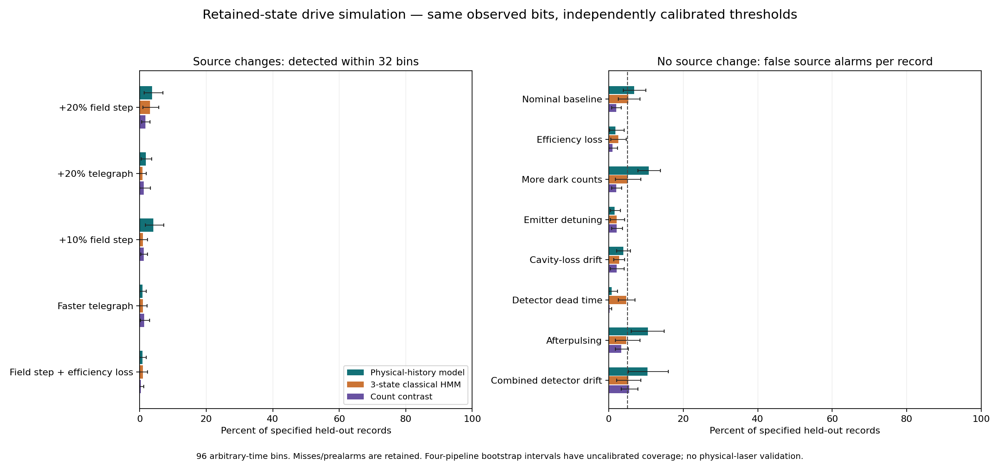
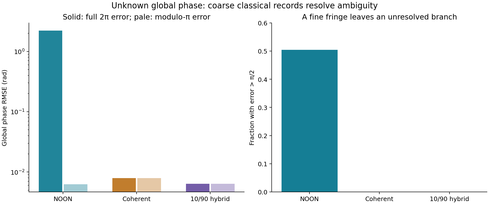

# Research followups: what we learned and what to do next

Research snapshot: 11 November 2026. This report covers new local experiments after the frozen finals presentation. All new optical, sensor and process results are simulations. Archived IBM results in the original project remain separate evidence of circuit implementation.

**The declared local research program is complete and independently checked, at a defensible research stopping point.** The results include favorable, negative and inconclusive findings. Physical validation and the further model families listed below remain future work.

This is the current status index. Preserved earlier roadmaps and READMEs may still describe the amplitude experiment, independent solver or full-grid construction as proposed. Their original text is retained for provenance; this report and the completion audit identify the newer results.

The most useful direction is a calibrated, complementary diagnostic measurement with an explicit conventional comparator. These experiments support that research question; they do not yet establish a practical laser monitor or chipmaking advantage. They also reveal where detector behavior, reference drift, model assumptions and circuit cost can defeat an appealing quantum result.

## What the original QRSM contributes

A click is one recorded event in a time bin, not a label saying “defect.” The QRSM connects each outcome to a modeled hidden quantum state. Conditioning that state on the observed record changes its prediction for later clicks. Comparing record likelihoods lets us test candidate interactions, noise and readout models. This computation can run classically; the separate reversible-circuit contribution is to amplify selected histories while preserving the conditional answer in the ideal full-reflection construction.

This matters because an unwanted coupling can change a qubit's state before readout, while a detector imperfection can change the recorded bit. Confusing those mechanisms produces a misleading diagnosis. Better modeling may help decide which calibration or physical intervention to test, but a fitted model is not automatically a unique explanation. Neither more accepted samples nor a good likelihood alone establishes faithful state inference.

The new dead-time experiment provides a concrete example. Ignoring a blind detector bin pushed inferred coupling to **0.069** when the synthetic truth was **0.65**. Including the blind-bin dynamics moved it to **0.706** and improved held-out prediction by **0.4584 nats per 24-bin record** (conditional 95% interval 0.3978–0.5210). Other fitted parameters remained biased or on a boundary. The result supports explicit detector modeling, not a claim that every hidden defect has been identified.

## Evidence and decisions

| Study | Completed evidence or current status | Research decision |
|---|---|---|
| Correlated spatial process | Exact conditional sampler; explicit 2×2 preparation, oracle and amplification; nine bounded noisy circuit cases | Correlation changes rare-event probabilities, but this model has a strong exact classical solution. |
| Original 49-cell spatial process | Twelve million evaluation maps, probability brackets, tuned importance sampling, actual full-grid circuits and independent component/wiring checks | Classical baseline is stronger than the original fixed proposal. Full circuit resources must be charged. |
| Quantum-light exposure | Nine cases, five source methods, 540,000 weak-activation realizations, 140 sensitivity rows; raw optical-moment supplement | Fine fringes alone do not establish finer manufactured features or favorable throughput. |
| Optical phase inspection | 168,000 estimation trials with loss, source attempts, phase ambiguity and charged coherent pilots | A hybrid has a conditional precision benefit in an efficient model; loss and poor preparation can erase it. |
| Unknown-onset laser frequency sensing | 23,040 held-out records across independent simulated sessions and calibrations | Atomic information helps the chosen receiver modestly; a second conventional reference wins this benchmark. |
| Changing emitter drive amplitude | Four independent calibration/training pipelines, 6,656 held-out records across 13 scenarios; independent main and prior-only reviews | This particular retained-state sensor/filter regime fails to provide useful prompt amplitude-change diagnosis. |
| QRSM dynamics and inference | Independent QuTiP solver, 6,000 trajectories, cutoff sweep, six joint-fit cases and derivative audits | Predictions can be useful while physical parameters remain ambiguous. Detector and numerical errors need explicit tests. |
| Three-bin coherent optical histories | Two ideal circuit approximations and bounded one-bin noisy checks | Generic synthesis is too costly to justify a hardware run simply to repeat a noisy amplification result. |

### Laser diagnosis with an additional reference

The new frequency study hides the event onset and calibrates alarms over the entire 128-second record. At the nominal setting, timely detection within 32 seconds is **51.35%** for the chosen conventional receiver, **58.02%** with the atomic channel, and **97.97%** with a second conventional reference. Corresponding full-record false alarms are 5.42%, 5.16% and 4.06%. The atomic addition's paired improvement is 6.67 percentage points (pipeline/session-bootstrap interval 3.96–9.38).

The failure cases change the conclusion. Degraded atomic coherence makes adding that channel worse than the conventional receiver alone. An agreement rule reduces one reference-drift failure but loses sensitivity and still exceeds the nominal false-alarm target. A shared sampled-path shift remains indistinguishable from source frequency in this measurement model. An extra lens is useful only when its independent information and calibration survive these controls.

These are hypothetical 698 nm laboratory assumptions with slow sampling and substantial interrogation dead time. They do not demonstrate a DUV/EUV-compatible monitor. Support-light, cooling, reference and apparatus costs are not fully matched. See [protocol, results and uncertainty](laser_sensor_viability/followup/README.md).

### Direct drive-amplitude diagnosis

This directly tests the proposed photon/emitter route in the companion emitter–cavity model. Its Hamiltonian's drive is an effective field-amplitude parameter; fluorescence clicks are output observations, not counts of the incident lithography beam. A +20% field change corresponds to +44% intensity only under fixed coupling assumptions. The model provides no calibrated conversion to incident watts, pulse energy or wafer dose.

The emitter–defect–cavity state persists across source changes. The estimator receives the clicks and the specified schedule distribution, never the actual source path. Four independently seeded calibration/training pipelines evaluate 13 source, detector and emitter scenarios. All pipelines share the same nominal physical parameters; the scenario changes are the tested counterfactuals. The alternatives target increased drive. A negative-source-change instrument and an independently engineered conventional optical detector are outside this experiment.

| Same-record estimator | +20% field step detected within 32 bins | False alarms in a stable-source 96-bin record |
|---|---:|---:|
| Physical-history filter | 3.71% (19/512) | 6.84% |
| Three-state classical HMM | 3.13% (16/512) | 5.27% |
| Adjacent-window count contrast | 1.76% (9/512) | 1.95% |

All thresholds use separate null records and a nominal 5% whole-record target. Count ties make that comparator conservative; the realized false-alarm rates are not identical. The physical-minus-HMM timely-detection difference is only 0.59 percentage points, with a descriptive hierarchical interval of −1.76 to +3.32 points. Misses and premature alarms count in the physical filter's **31.60-bin restricted delay out of a possible 32**. Four calibration clusters limit uncertainty precision.

The records contain about 20 binary clicks in 96 arbitrary-time bins. Under increased dark counts and afterpulsing, false source alarms reach **10.74% and 10.55%** in the nominal physical filter. Combining a true source step with efficiency loss reduces timely detection to **0.78%**. These results do not support useful prompt source diagnosis at this operating point. They do not establish an intrinsic limit for every quantum sensor, drive strength, observation duration or estimator.

Drive estimation illustrates another trap. On +20% source steps, normalized RMSE falls from 0.1785 for keeping the calibrated baseline unchanged to 0.1125 for the physical posterior mean. But on a genuinely stable source, that mean has **+6.94% bias** and RMSE 0.0786, whereas the calibrated baseline happens to match the generator in all four pipelines.

A separately labeled, post-holdout descriptive control ignores the detector bits and uses only the **same fitted schedule prior**. It already achieves step RMSE **0.1136**, nearly the observation-based result. The incremental paired MSE improvement is just 0.0002515 (descriptive four-pipeline interval 0.0000788–0.0004460). For the telegraph, +10% step, faster switching and step-plus-efficiency-loss cases, incorporating observations actually worsens RMSE relative to that prior-only estimate. Most of the apparent source-case improvement over a constant comes from the prior assumptions. No main records, fits or thresholds were changed for this control.

The source-state filter is classical numerical inference on a specified quantum model. Its failure does not call for an IBM job: a quantum processor cannot supply the missing physical calibration or automatically make these observations more informative. See [full protocol, counterfactuals and raw-record audit](qrsm_photon_poc/drive_diagnostics_followup/README.md).

Figure: timely source detection is weak, while some detector changes produce false source alarms. The left panel uses eligible source-onset records; the right uses complete source-stable records. Both axes run from 0% to 100%. These are different operational metrics, not interchangeable probabilities.

### Optical inspection: a favorable result with clear conditions

At 81% total transmission/detection efficiency and 20,000 mean photons incident on the object, a fully charged hybrid of 10% coherent observations and 90% two-photon quantum observations gives global phase RMSE **0.00637 rad**, versus **0.00791 rad** for the specified coherent comparator. Both modes illuminate the object, all incident photons are counted, and the common phase-bias calibration is assumed known.

Pure two-photon NOON light has a π-periodic likelihood. Its small within-branch error hides a roughly 50% wrong-branch rate for an unknown phase over 2π. The coherent portion resolves the ambiguity in this finite test; zero branch errors in 2,000 trials still has a 95% upper bound of about 0.192%. Greater loss can remove the precision benefit. At low preparation success, the equal-time benefit disappears; equal-dose precision is retained only by waiting longer. This is an established metrology mechanism reproduced in a specified model, not a new principle or a fabricated inspection instrument.

The result motivates a calibrated optical test-object experiment more directly than an industrial exposure claim. It does not yet map phase to a material defect, feature size or wafer quality. See [full equations, budgets and limitations](quantum_lithography_poc/phase_inspection_followup/README.md).

Figure: the efficient case at 20,000 mean object-incident photons. Solid bars show the actual full-2π task error; pale bars show error only within a π branch. The latter alone would conceal pure NOON's ambiguity. All hybrid pilot photons are included.

### Quantum-light exposure: better contrast is only one requirement

The exposure study includes ordinary coherent light, incoherent photons, phase-cycled coherent illumination and a declared high-peak-power conventional comparator. The latter uses 10% duty cycle and ten times the active brightness. It is a different peak-power allowance, not a universal classical bound.

In the nominal illustrative model, the quantum source improves the chosen threshold-pattern accuracy, but it requires more photon dose than some conventional alternatives. An optimized toy guard-cell score is 95.16% for the quantum source; the probability of getting **all 20** guard cells right is only 36.76%. Boundary cells are excluded by definition. These numbers are not wafer yield. Loss, blur, linear activation and preparation-related background can remove the benefit. At 1% preparation success, equal photon dose takes 100 times as long as with an always-available coherent source.

The new raw-moment supplement separates optical **G1** and **G2** from material response. G1 is mean local photon number; G2 is the local factorial second moment relevant to the assumed two-photon response. It includes ordinary phase-cycled light's fine harmonic and charges both exposures. Post-activation blur is applied to the response, not mislabeled as an optical correlation. Resist coefficients, weak-activation statistics and spatial cells remain hypothetical. See [exposure study](quantum_lithography_poc/exposure_followup/README.md) and [moment definitions](quantum_lithography_poc/exposure_followup/MOMENT_SUPPLEMENT.txt).

### Spatial failures and computational cost

In a correlated 2×2 model, sharing one source-dose fluctuation increases the low-response probability by **2.61×** over independent cells with the same individual distributions. Actual ideal circuits reproduce the exact conditional law. One round raises acceptance from 0.3707% to 3.3030%, using 988 generic CX gates for an enumerated predicate or 1,052 for the weighted-sum construction. An exact classical dynamic program samples the same conditional law without rejecting complete histories.

On the original independent 7×7 process, deterministic discretization bounds now constrain its rare-event probabilities. A separately pilot-tuned exponential importance proposal reduces run-to-run standard deviation by **4.36× and 7.32×** at the two tested doses relative to the original fixed proposal. The older proposal's nominal 95% intervals cover the reference in only 86 of 100 runs at the rarer setting. All pilot samples are counted; uncertainty in these coverage estimates is reported. These are positive additive surrogate models, not calibrated resist chemistry.

The **full 49-cell process now has actual constructed circuits**, with a count cap and two bounded approximations to the response weights. The explicit clean-ancilla implementations use **389 qubits** and have constructive one-round generic CX upper bounds of **2,874,028 and 3,382,108**. These are costs of the chosen implementations, not lower bounds or optimized routed hardware counts. Both complete circuits were serialized and read back successfully. The compact 219-qubit form is also constructed, but its large abstract controlled gate cannot be read by the installed QPY implementation; this limitation and earlier memory-guard failures are preserved.

Component truth tables, carry arithmetic, a reduced coherent example and full circuit wiring are checked. **The 389-qubit state was not simulated.** Event and conditional-distribution approximation bounds come from the positive additive model and finite encoding, not from pretending to execute that statevector. This closes the construction gap and makes the near-term hardware obstacle concrete.

Some preserved earlier study documents say the full-grid circuit is unimplemented; they describe their own historical snapshot. Use this dated report and the [full construction, error budget and resource ledger](finals-lithography/full_spatial_circuit/README.md) for current status. See also [small circuits and classical comparison](finals-lithography/followup/README.md).

### QRSM numerical validity and coherent histories

Independent QuTiP dynamics agree with the original matrix-exponential implementation within 2×10⁻⁹ at the checked finite dimensions. The cavity cutoff itself still matters: the original two-level cavity differs from the larger numerical reference by up to 7.08 percentage points in a conditional click probability at the higher-drive setting. Matching a circuit to its own finite model therefore does not prove physical convergence.

Joint fits estimate coupling, detuning, dephasing, efficiency and drive. The controlled synthetic tests predict held-out records better than the fitted three-state HMM, while fixed-setting differences are unresolved. The physical model shares known structure across controls; all these likelihood calculations run classically. Fixed-control detuning has an exact sign ambiguity. Controls break that structural symmetry but do not give confident sign identification in the finite tested data. Boundary solutions and unphysical local Gaussian interval endpoints remain visible. See [six-case inference and solver audit](qrsm_photon_poc/followup/README.md).

Three-bin optical circuits also pass ideal checks. The finer approximation uses **18 qubits and 19,864 generic CX gates** for one amplification round of the all-click event. In a separate one-bin noise experiment, recorded acceptance rises while the accepted conditional state can become substantially wrong. Increasing hits cannot substitute for checking the returned state or distribution. Three-bin noisy density simulation was outside the declared local memory budget; it was not silently treated as passed. See [coherent histories and bounded noise](qrsm_photon_poc/multibin_followup/README.md).

## What is complete, what remains research, and what requires measurements

The original numbered roadmap requests are reconciled in the [completion audit](research-validation/completion_audit.json). The bounded scope is the seven workstreams in [the continuation plan](RESEARCH_CONTINUATION_PLAN.md), with the full-grid construction and phase-inspection study as explicit substudies. The goal is a checked research stopping point, not the claim that every possible sensor or lithography model has been exhausted.

Further **local model research** remains possible: slow stochastic spectral diffusion, thermal and multimode cavities, non-Markovian environments, arbitrary pulse/control optimization, joint phase-and-loss inference, and stronger classical state-space methods. A coherent oracle for a learned, time-varying drive model also remains unimplemented; the three-bin coherent study uses its separately specified fixed model. These are untested alternatives rather than laboratory blockers. A limited detuning-step counterfactual does not establish general robustness to spectral diffusion.

The next physically meaningful diagnostic study needs:

1. A defined measurand and monitoring location: amplitude, frequency, phase or pulse property, with wavelength and required bandwidth.
2. Measured coupling, source brightness/preparation success, reference stability and detector response, including dead time and afterpulsing.
3. Synchronized records from the candidate sensor and a strong conventional reference under independently commanded source and detector changes.
4. Calibration/training runs separated from blinded test conditions, with false alarms, latency, parameter uncertainty and total acquisition cost reported.
5. For chipmaking relevance, measured exposure-transfer and material-response data connecting that measurand to process quality. No dollar savings or yield number follows without them.

These inputs would let the team ask whether the added observation changes a useful engineering decision. Lower-noise qubits and reliable sources are valuable only insofar as they improve the relevant end-to-end accuracy and operating cost; this project has not measured the financial return.

## IBM access and delivery

**No IBM API key is needed for this research snapshot.** No new jobs were submitted. The large optical/process circuit costs do not justify using hardware just to obtain another noisy result. If a shallower circuit answers a distinct remaining implementation question, the next proposal should specify qubits, gates, shots, calibration controls, usage and an interpretation criterion before submission. Credentials should stay in the local account configuration, outside chat, source and archives. Hardware would check circuit execution; it would not validate optical coupling, a laser diagnosis or resist chemistry.

The existing 9:20 finals deck, application and MP4 assets remain the presentation reference. These new findings are a separate research delivery; the older known-onset sensor percentages must not be replaced by unknown-onset numbers without changing the explanation of the task. The research report makes no change to the documented team roles or rubric mapping.

## Reproducibility

Each study directory retains its protocol, sources, seeds, results, assumptions, checks and provenance. Use its README for exact commands. The shared audited environment is [research_requirements.txt](research-validation/research_requirements.txt), with Python 3.12.10. Set `OPENBLAS_NUM_THREADS=1` and `OMP_NUM_THREADS=1` for the recorded bounded runs. Full experiment regeneration can be substantially more expensive than checking saved artifacts.

`Rewind_Amplify_Research_Followups.zip` is the separate portable research archive. Extract it with its folder structure intact and open `RESEARCH_RESULTS.md`. Run `python verify_research_pack.py .` inside the extracted folder to check every listed file's SHA-256; this standard-library check verifies artifact integrity, not scientific correctness. The full construction QPY files require a compatible Qiskit environment to load. These circuits are not suitable for a desktop statevector run.

The integrated [validation receipt](research-validation/research_checks.json) rechecks study provenance and completed reviews. Archived preliminary and failed bounded attempts are provenance, not additional independent evidence. Failed and superseded full-grid circuit binaries are omitted from the portable archive; their attempt reports and source remain. The validation receipts distinguish analytic/component checks, finite statistical checks, circuit construction, ideal simulation and noisy simulation.

AI assistance: Codex and its collaborating agents implemented and reviewed these numerical extensions. Independent software/physics checks in this report mean separately implemented or reviewed numerical checks, not independent laboratory replication or external peer review.
