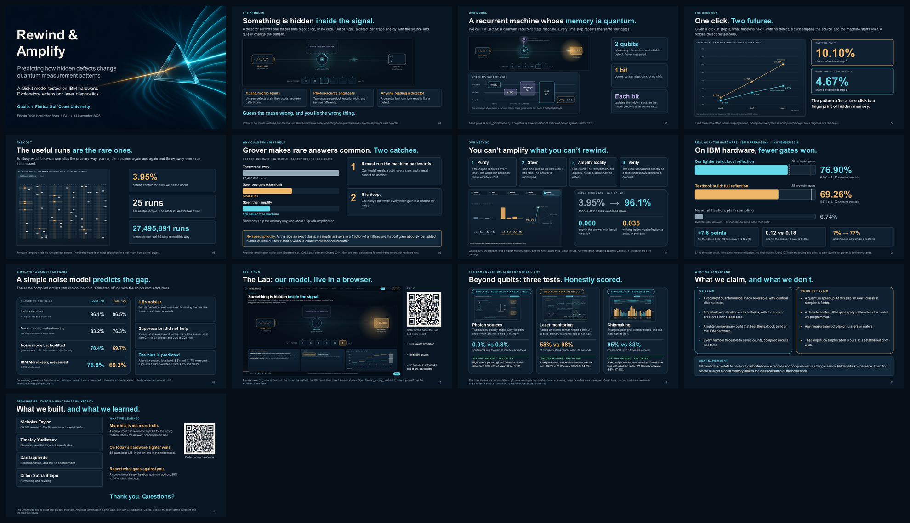
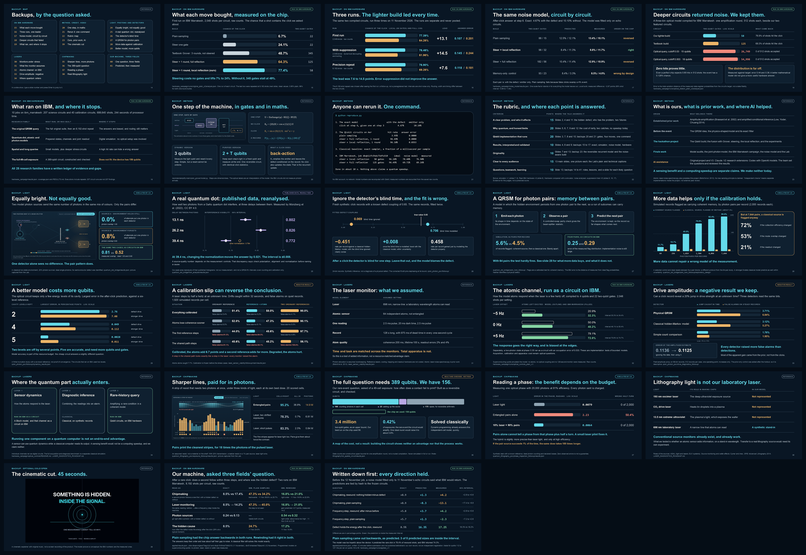

# The finals deck

**Present this file:** [`Rewind_Amplify_Finals_V3.pptx`](Rewind_Amplify_Finals_V3.pptx). Thirteen main slides planned for 9:25, then 28 backups in the same style. Speaker notes are inside, and the same text is in [`Presenter_Guide_V3.md`](Presenter_Guide_V3.md).



| File | Use |
|---|---|
| `Rewind_Amplify_Finals_V3.pptx` | The talk. Slides 10 and 39 hold real, playable videos. |
| `Rewind_Amplify_Finals_V3.pdf` | Static fallback. Videos appear as still frames; there are no notes. |
| `Presenter_Guide_V3.md` | Narration, timing, cues and sources for every slide |
| `v3_notes.json` | The speaker script and the backup notes. Edit this, then rebuild. |
| `v3_manifest.json` | What the deck contains and the hash of every result it quotes |
| `v2/` | The V2 deck, kept exactly as it was published |

## The backups

Slide 14 is a map of the backups, grouped by the question a judge might ask: on IBM hardware (15 to 19), method and credit (20 to 23), light (24 to 29), lasers (30 to 34), chipmaking (35 to 38), the cinematic cut (39), and our own machine asked those three fields' question on IBM (40 and 41).



Every backup states its finding in the title, and carries a chip in the top right corner that says what kind of evidence it is: ran on IBM hardware, simulated by us, published data reanalysed, or a negative result. Its speaker note starts with **SHOW THIS WHEN**, followed by what to say and where the numbers live.

## Playing the videos

In PowerPoint's slide show, click a video once to play it. Slide 10 is a silent 70-second recording of the Lab: talk over it. Slide 39 is the team's cinematic cut, with music.

Embedded video plays in PowerPoint for Windows and Mac. It does not play in the PDF and may not play in Google Slides or Keynote. If the venue's computer cannot play it, use the loose files in [`../media/`](../media/) or open [`../Rewind_Amplify_Lab.html`](../Rewind_Amplify_Lab.html) and press the tour button.

Short on time: stop the slide 10 video at 41 seconds, when the IBM hardware scene ends. [`../media/lab-tour-45s.mp4`](../media/lab-tour-45s.mp4) is a 45-second recording without the three research tabs; `--lab-video` swaps it in.

## Changing the deck

Small edits (wording, a speaker name, slide order) can be made directly in PowerPoint. Afterwards run `python finals-deck/finish_v3_deck.py` so the manifest matches the file, or `check_finals.py` will report a mismatch.

To change what is said, edit `v3_notes.json` and rebuild. To change a main slide's layout, edit `build_v3_deck.py`; for a backup, `v3_backups.py`. Both draw with `deck_kit.py`, which holds the palette and the slide furniture.

To swap in a newer cinematic cut, or the shorter Lab video, pass it to the builder:

```bash
python finals-deck/build_v3_deck.py --cinematic path/to/new_cut.mp4
python finals-deck/build_v3_deck.py --lab-video media/lab-tour-45s.mp4
```

## Rebuilding from scratch

The slides read their numbers from the saved results when they are built, and most pictures are captures of the running Lab. So a full rebuild is a short list of commands, run from the repository root:

```bash
python lab/capture.py deck                 # the Lab panels the slides show
python lab/capture.py tour                 # media/lab-tour.mp4, about five minutes
python finals-deck/build_v3_deck.py        # the PowerPoint
powershell -ExecutionPolicy Bypass -File finals-deck\finish_v3_deck.ps1    # PDF and previews, through PowerPoint
python finals-deck/finish_v3_deck.py       # presenter guide, contact sheet, manifest
python check_finals.py --public
```

Requirements: `pip install -r requirements-tools.txt`, an installed Chrome or Edge for the captures, and Microsoft PowerPoint for the PDF step. The science code needs none of these.

Only the cover comes from the V2 deck. The V2 deck itself was built with a tool that is not redistributed; see [`v2/BUILDING.md`](v2/BUILDING.md).

## What the check enforces

`python check_finals.py --public` fails if any of these stop being true:

- 13 main slides, each with notes that match `v3_notes.json`
- a contiguous talk plan that ends at 9:25, at least 30 seconds inside the limit
- 28 backups, each carrying its note, and every slide after the cover on the one dark background
- two embedded MP4 videos with their media relationships and timing nodes, not pictures of videos
- the deck, PDF and guide have the hashes recorded in the manifest
- every saved result that a slide quotes still has the hash it had when the deck was built
- PowerPoint opened the file without repairing it
