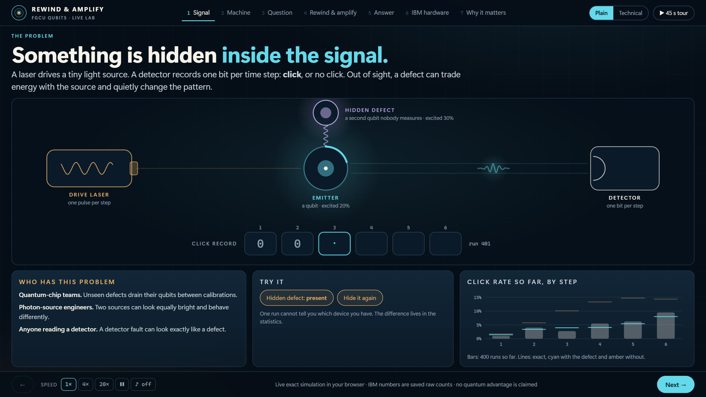

# The Lab

A live, exact simulation of the Rewind & Amplify model, in a browser. Open [`index.html`](index.html) in Chrome or Edge, or use the single file [`../Rewind_Amplify_Lab.html`](../Rewind_Amplify_Lab.html). Nothing to install, no server, no network.



## What it shows

| Scene | The point |
|---|---|
| 1. Signal | A laser drives an emitter; a hidden defect trades energy with it; a detector records one bit per step |
| 2. Machine | One step of the model, gate by gate, with the Qiskit code and the hidden state updating live |
| 3. Question | Given a click at step 3, what happens next? Runs pile up, and almost all are thrown away |
| 4. Rewind & amplify | Prepare, mark, rewind, reflect, replay: the amplitudes of the eight three-step records, computed live |
| 5. Answer | The two futures, 10.10% and 4.67%, with a slider for the defect's coupling |
| 6. IBM hardware | The measured counts beside the ideal simulator and the noise model |
| 7. Why it matters | Who could use this, what we claim, and what we do not |

Every scene has plain and technical captions. Press **T** to switch.

## Controls

| Key | Action |
|---|---|
| ← → | Previous and next scene |
| 1 to 7 | Jump to a scene |
| T | Plain or technical captions |
| R | Reveal or hide the defect |
| D | Add or remove the defect |
| Space | Pause the simulation |

The **45 s tour** button plays all seven scenes on a timer, for a presenter to talk over.

Address-bar options, for setting up a screenshot or a demo: `?level=tech`, `?reveal=1`, `?speed=4`, `?runs=2000`, `?stage=3`, `?seed=7`, `?tour=1`, followed by `#scene`, for example `index.html?level=tech&reveal=1#machine`.

## Why it can be trusted

The animation is not a cartoon of the physics. [`engine.js`](engine.js) builds the same circuits, gate for gate, as the Qiskit package in [`../rewindandamplify-main/qrsm_grover/`](../rewindandamplify-main/qrsm_grover/), and simulates them as a statevector. The page stores no answers for the model: 4.67%, 10.10% and every amplitude on screen are computed when you open it.

Two test files hold it to that:

```bash
node --test lab/test_engine.cjs lab/test_data.cjs
```

- [`test_engine.cjs`](test_engine.cjs): Kraus operators, history probabilities, and the complete query circuit for both models and all four builds agree with Qiskit to 10⁻¹². Reference values come from the frozen file `research-validation/original_after_click_verification.json` and from [`reference.json`](reference.json), which [`make_reference.py`](make_reference.py) writes from the Qiskit package.
- [`test_data.cjs`](test_data.cjs): every measured number on the hardware scene is recomputed from the campaign's saved files, including both total-variation distances from the measured histories. [`data.js`](data.js) is generated by [`make_data.py`](make_data.py) and records the hash of each file it read.

The measured numbers are raw counts from real IBM jobs. The Lab submits nothing and contacts nothing.

## Files

| File | Role |
|---|---|
| `index.html`, `styles.css`, `app.js` | The page |
| `engine.js` | The exact simulator: statevector, the model's gates, Kraus operators, amplification with any reflection |
| `data.js` | Measured IBM numbers, generated. Do not edit by hand. |
| `reference.json` | Qiskit-side reference values for the tests, generated |
| `make_data.py`, `make_reference.py` | The generators, each with a `--check` mode |
| `build.py` | Writes `../Rewind_Amplify_Lab.html`, with a `--check` mode |
| `capture.py` | Records stills, slide panels, a README loop and the 45-second tour |
| `check_browser.py` | Opens every scene in a real browser and fails on any error |

## Changing it

```bash
python lab/build.py                 # after editing the page: rebuild the single file
python lab/make_data.py             # after a saved hardware result changes
python lab/make_reference.py        # after the Qiskit package changes (it should not)
python lab/check_browser.py         # every scene, both caption levels, folder app and single file
python lab/capture.py stills        # media/lab-*.png
python lab/capture.py tour          # media/lab-tour.mp4
```

The capture and browser tools need `pip install -r requirements-tools.txt` and an installed Chrome or Edge. The recorder steps the page frame by frame with a fixed random seed, so the video is a real recording of the running page and comes out the same every time.
