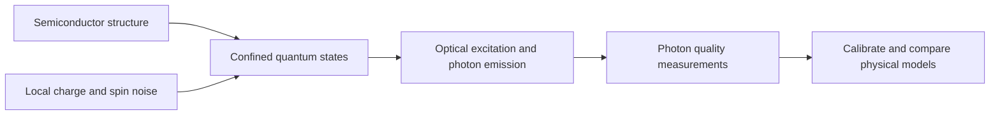

# Quantum dots: a bridge from semiconductors to photon quality

**Research extension, 11 November 2026.** A bounded quantum-optics benchmark and separately attributed experimental reference. This is not a fabricated device, a microscopic defect diagnosis, or a new quantum-advantage result.

A semiconductor can do more than switch current. Confinement can give its electrons and holes discrete quantum states; an optically active quantum dot can emit a photon when an excited state decays. The surrounding solid also introduces charge, spin and vibrational noise. That makes the dot a concrete meeting point for **semiconductor engineering, quantum-state dynamics and optical measurement**. Size-dependent confinement in semiconductor nanocrystals is explained in the [Nobel scientific background](https://www.nobelprize.org/uploads/2023/10/advanced-chemistryprize2023.pdf); composition, strain, barriers and electrical control also matter in epitaxial devices.



## What we learned for the original QRSM project

The semiconductor question is concrete: **does a photon source deliver photons that can perform the required interference operation, and which measurements can distinguish possible causes when it does not?** Our calculations establish requirements for that investigation. They check established optical physics; they do not introduce a new interference effect.

| What we actually checked | What it teaches the QRSM project | Possible engineering use after device validation |
|---|---|---|
| At the same imposed brightness and zero multiphoton emission, the four model cases have overlaps 1.00, 0.50, 0.20 and 0.25. | A model cannot infer every useful property from photon counts alone. Choose a measurement that is sensitive to the proposed mechanism. | Qualify photon sources using interference quality as well as delivered counts and multiphoton suppression. |
| With the same individual-photon frequency distributions, persistent versus independently redrawn offsets give pair overlaps 1.00 versus 0.60. | Retaining environmental correlations can change predictions that independent-event descriptions miss. This example has classical memory; an HMM remains a relevant comparator. | Test source quality at photon separations relevant to the intended circuit, rather than relying on one averaged spectrum. |
| In external GaAs data, the last corrected contrast is 0.7724 with our primary normalization and 0.7938 with the co-only alternative. | The observation model and its controls can change the inferred answer. This parallels the original detector-aware QRSM lesson: measurement errors can masquerade as physical changes. | Check polarization, timing, routing and reference normalization before attributing poor interference to the emitter. |
| Independent photon survival falling from 0.8 to 0.2 requires 16 times as many attempts for equal expected surviving-pair counts. | Useful information must be evaluated with the acquisition cost that produces it. | Compare an operating point or filter by both photon quality and delivered-pair yield. |

The original QRSM retains a hidden state, updates it after an observed outcome, and predicts later observations. A dot's selected optical transition could take the emitter role; a candidate local environment could supply the hidden dynamics. **That is a proposed physical mapping, not a completed device fit.** The new [sequential joint-photon extension](qrsm_hom_followup/README.md) now implements explicit emitted photon modes, a two-photon HOM observation instrument and conditional environmental updates. Its reversible circuits digitally emulate this bounded full-emission model. It differs from the original repeated drive/exchange instrument. No quantum-dot model has been fitted to the six aggregate histograms, which do not supply per-pulse trajectories.

The current dot benchmark and histogram analysis run classically. The prescribed offset memory is classical, and it does not establish a need for coherent hidden qubits. Grover-style amplification would subsequently ask conditional questions of a specified reversible model; it does not replace acquiring the missing interference measurement or prove a computational speedup here.

## New joint-observation result and its limit

The implemented instrument exposes an informative negative result: passive HOM observations are exactly uninformative about the specified coherent versus dephased environmental hypotheses. In the frozen controlled 64-pair simulation, detection is only 5.60% against 4.50% false flags. Implementing a hidden quantum state does not guarantee observability or a useful diagnosis.

A [separate exact control exploration and fresh validation](qrsm_hom_followup/exploratory_design/README.md) uses a new gap rotation and perfectly resets the environment between four-pair blocks. It reaches 79.75% nominal detection at 2,584 attempted pairs and 4.85% nominal false flags. This is a different control/preparation budget, not a replacement of the earlier negative result. At 7,644 pairs, unmodeled collection, mode-overlap and readout changes still produce 72.00%, 53.25% and 21.05% false flags on classical sources. More data amplify model mistakes unless those alternatives are calibrated and included.

An eight-state HMM trained on the same 20,000 blocks predicts about as well as the specified physical model; its paired score-difference interval includes zero. All twenty HMM starts reached their 200-iteration cap, so global fitting optimality is not asserted. The exact classical categorical law reproduces each finite-block distribution by construction. The contribution is an explicit physical measurement model, conditional resource bounds and controls that reveal ambiguity—not uniquely quantum defect identification.

Separate digital bundles cover up to four emitted pairs (22/29-qubit selected coherent/dephased circuits), with exact conditional references and independent MPS/QPY checks. Actual IBM executions and their gate/readout limitations are tracked by the [hardware campaign](../hardware_campaign/README.md). These components do not reproduce an optical detector, physical environmental reset, semiconductor device or complete multi-thousand-pair acquisition study.

## A proposed semiconductor-device workflow

The nearest practical user is an engineer characterizing a single-photon source for a quantum photonic chip. [Davanco et al.](https://www.nist.gov/publications/heterogeneous-integration-chip-quantum-photonic-circuits-single-quantum-dot-devices) demonstrated quantum-dot devices coupled into integrated silicon-nitride photonic circuits, providing a real device context. Our proposed workflow is:

1. Measure delivered counts, multiphoton suppression and photon interference at the delays required by the intended circuit; retain calibration and acquisition cost.
2. Check reference brightness, polarization, timing, routing and detector response. Independently vary source bias, excitation or temperature where the platform permits.
3. Compare candidate physical hidden-state models and classical alternatives on records not used for fitting. Test whether the predicted response to a controlled change actually occurs.
4. Use those validated measurements to select or tune a source and decide which component to investigate. A uniquely identified microscopic defect or improved fabrication yield needs further evidence.

This is a source-characterization application within semiconductor quantum photonics. Monitoring a lithography laser is a separate transfer problem requiring a compatible coupling scheme and measured process relevance.

## Which kind of quantum dot?

| Platform | Physical role | Connection to this project |
|---|---|---|
| Optically active GaAs/InGaAs/InAs-family dots | A selected exciton or charged optical transition emits photons; some devices also host spin qubits | The closest match to our emitter, hidden environment and photon-detection models |
| Gate-defined silicon/SiGe dots | Electrostatic gates confine carriers; electron spin can encode a qubit | A separate semiconductor-computing direction with different control and measurement physics |
| Colloidal semiconductor nanocrystals | Confinement changes absorption and emission, with uses including displays | A useful introduction to confinement; an ensemble of fluorescent dots is not automatically a coherent single-photon or spin-qubit device |

These platforms should not be merged into one performance claim. [Gao et al.](https://www.nature.com/articles/nature11573) demonstrated a quantum-dot spin–photon entanglement interface. [Philips et al.](https://www.nature.com/articles/s41586-022-05117-x) demonstrated a six-spin-qubit silicon processor. Neither result is reproduced by the small model in this folder.

## A practical question: does bright light mean useful photons?

Photonic quantum circuits often need photons that match well enough to interfere. Counting photons alone does not measure all their optical-state information. Charge noise can shift a dot's transition, while other processes cause dephasing. [Kuhlmann et al.](https://arxiv.org/html/1301.6381v1) used quantum-dot resonance fluorescence to distinguish charge- and spin-noise signatures. This is established experimental work, not a capability newly established by our simulator.

| Measurement | What it can reveal | What it cannot establish alone |
|---|---|---|
| Photon count or brightness | Collected flux, blinking, loss and some excitation changes | Phase coherence or a unique cause of a change |
| Spectrum, linewidth and lifetime | Transition shifts, spectral broadening and population decay | The complete correlated noise dynamics |
| Hanbury Brown–Twiss correlation, `g2(0)` | Suppression or presence of multiple-photon emission | Whether photons emitted at different times occupy matching modes |
| Hong–Ou–Mandel (HOM) interference | Two photons' mode overlap under a calibrated interference measurement | Unique identification of a charge trap, laser drift or a semiconductor defect |

In an ideal HOM comparison, two matching single photons enter opposite ports of a balanced beamsplitter and leave together. More distinguishable photons produce more coincidences between its outputs. [Thoma et al.](https://arxiv.org/html/1507.05900v2) used varying photon separation and temperature to probe dephasing and memory in a semiconductor emitter. Their noise model and fitted parameters are different from our illustrative two-state environment.

This is a concrete version of the project's “another lens” idea: choose an additional measurement that sees a physically relevant property the existing record does not contain.

## Our bounded model

The [design record](PROTOCOL.md) fixes illustrative parameters before the benchmark run. One chosen dot transition is approximated as a two-level radiative emitter. It is ideally prepared once per pulse. This does **not** calculate a semiconductor band structure, predict emission wavelength from dot geometry, or include every exciton, spin, cavity and phonon process.

For radiative decay `Gamma = 1/T1`, pure coherence-decay rate `gamma_star`, and frequency offset `nu` in Hz, the normalized emitted-photon density kernel is

```text
rho(t,t') = Gamma exp[-Gamma(t+t')/2]
                  exp[-gamma_star |t-t'|]
                  exp[-i 2*pi*nu (t-t')],  t,t' >= 0.
```

For two photons with equal lifetime/dephasing and differential frequency `delta_nu`, independent fast dephasing gives the overlap

```text
M = Gamma (Gamma + 2*gamma_star)
    / [(Gamma + 2*gamma_star)^2 + (2*pi*delta_nu)^2].
```

With no differential detuning, `M = T2/(2*T1)` and `1/T2 = Gamma/2 + gamma_star`. This familiar Markov limit is not a universal formula for arbitrary colored noise. A shared frequency shift cancels: this measurement sees a difference, not an absolute optical frequency.

The model also compares two classical frequency offsets with persistent versus independently redrawn states. The switch probability describes a selected photon pair; no experimental delay or switching rate is inferred. It is **classical environmental memory**, not evidence for a coherent hidden defect qubit. An HMM is an appropriate baseline for such a model.

Equal brightness and ideal `g2(0)=0` are imposed by our one-photon preparation and frequency-independent loss. Real narrowband excitation, imperfect pulses, nonradiative decay, blinking and detector artifacts can change those statistics. Polarization and timing mismatch can also reduce HOM interference without the phase-noise mechanism modeled here.

## Executed benchmark

The [saved results](results.json) use `T1=1 ns` and `eta=0.2`, with illustrative parameters rather than a device calibration:

| Model case | gamma_star / Gamma | Differential angular detuning / Gamma | Photon overlap M | Two-output coincidences per excitation pair |
|---|---:|---:|---:|---:|
| Ideal reference | 0 | 0 | 1.00 | 0 |
| Phase noise | 0.5 | 0 | 0.50 | 0.010 |
| Frequency mismatch | 0 | 2 | 0.20 | 0.016 |
| Both | 0.5 | 2 | 0.25 | 0.015 |

Every case has the same per-photon survival probability, 0.2, and ideal photon-number `g2(0)=0`. Thus, in this model, the count and purity measurements alone cannot distinguish sources with very different interference quality. In the separate two-state comparison, keeping the same single-photon frequency distribution but changing the pair switch probability from 0 to 0.5 reduces overlap from **1.00 to 0.60**. A photon pair contains correlation information absent from its separate marginals.


Validation includes **16 model tests**, a direct bosonic creation-operator beamsplitter test, five density-kernel quadrature checks and a [separate adaptive-integration check](independent_review.json) that does not import the model implementation. Four settings also sample 100,000 independent excitation pairs each; this checks sampling/accounting, not a new physical hypothesis. The external reference has five additional format/checksum tests. These are local numerical/code checks, not independent laboratory replication.

## Costs and what a useful diagnosis would require

For equal independent survival/detection probability `eta` per photon, a pair is available with probability `eta^2`. The ideal coincidence probability per excitation pair is `eta^2*(1-M)/2`; the distinguishable reference gives `eta^2/2`. Conditional overlap by itself hides acquisition cost. Moving from `eta=0.8` to `0.2` requires **16 times as many attempts** for the same expected number of surviving pairs, before background, calibration and stability costs.

A useful device study would collect synchronized counts, HBT/HOM histograms, lifetime and spectral/reference measurements; vary laser detuning, polarization, excitation power and gate bias in controlled ways; then test predictions on unused records against classical models. Inferring a noise correlation is different from identifying its microscopic physical source.

The QRSM contributes a conditional physical model: predict how observations depend on the emitter and its hidden environment, and test candidate explanations. Additional optical measurements may constrain states that click counts cannot. Grover-style queries operate on a specified model and do not recover information that the detectors never acquired. This benchmark runs classically and provides no computational speedup.

## External measurements and the bounded reanalysis

The repo already retains [external GaAs quantum-dot counts](../external_data/gaas_qd5/DATA_USE.md). They integrate photons for one second; every singles bin is nonzero. Converting those counts to bits loses the fine-time structure and cannot reconstruct photon interference.

The same authors separately released **co- and cross-polarized HOM histograms**. The [reference-data folder](reference_hom/README.md) imports those more suitable observables with source checksums and attribution. They remain an external experiment, not FGCU measurements or a fit of our model. The published three-delay result is approximately flat; it should not be presented as confirmation of a monotonic memory-decay prediction.

The [new HOM reanalysis](hom_analysis/README.md) follows a protocol recorded before its first normalized calculation. It integrates each central peak and four main reference peaks, normalizes within each acquisition and applies the paper's stated beamsplitter and multiphoton correction. The primary corrected contrasts are **0.8024, 0.8258 and 0.7724** for generation separations 13.1, 26.2 and 39.4 ns. Their 95% intervals are **[0.7943, 0.8113]**, **[0.8181, 0.8344]** and **[0.7647, 0.7808]**, conditional on the counting/calibration model. Shared calibration uncertainty is propagated across the three settings.

These estimates are close to the paper's printed values, but the authors' exact windows and normalization are unspecified. This is a conditional reanalysis, not an exact pipeline reproduction. Seventy predeclared window/background/reference choices per pair give ranges **0.7980–0.8144**, **0.8221–0.8393** and **0.7691–0.7877**; these are sensitivity ranges, not additional confidence intervals or bounds on all systematic errors. In the last pair, the cross-polarized central/reference ratio is 0.4591 rather than the approximate ideal 0.5. The paper's co-only normalization alternative changes our corrected value to **0.7938**. That dependence is useful diagnostic evidence about the extraction assumptions, not a unique identification of polarization error or a microscopic defect.

An independent standard-library implementation reproduces all primary peak areas and point estimates. The seeded Monte Carlo run is also reproducible. Three aggregated delay pairs do not identify a trap switching rate, dephasing mechanism or full photon state. A stronger next data set needs repeated/time-tagged measurements, matched polarization/routing and brightness controls, documented extraction settings, paired calibration and broader generation separations. Raw peak heights alone are insufficient.

## Connection to chipmaking

The most direct application is **quality characterization of semiconductor quantum-light devices and integrated photonic chips**. [Davanco et al.](https://www.nist.gov/publications/heterogeneous-integration-chip-quantum-photonic-circuits-single-quantum-dot-devices) demonstrated GaAs structures containing InAs/GaAs dots interfaced with silicon-nitride waveguides. That supplies a real device context for source quality, losses and fabrication consistency.

Using a dot as a probe of a lithography laser is a further transfer question. Wavelength compatibility, power handling, coupling and calibrated response must be established; this study does not establish suitability for DUV/EUV exposure tools or improved wafer yield. Designing and characterizing a semiconductor quantum device is already a meaningful semiconductor connection.

## Reproduce

From the repository root, with the development environment installed:

```sh
python -m unittest discover -s quantum_dot_bridge -p "test_*.py" -v
python quantum_dot_bridge/verify_results.py
python quantum_dot_bridge/reference_hom/import_verify.py
python -m unittest discover -s quantum_dot_bridge/reference_hom -p "test_*.py" -v
python -m unittest discover -s quantum_dot_bridge/hom_analysis -p "test_*.py" -v
python quantum_dot_bridge/hom_analysis/run_analysis.py --output quantum_dot_bridge/hom_rerun.json
python quantum_dot_bridge/run_study.py --output quantum_dot_bridge/results_rerun.json
python quantum_dot_bridge/plot_results.py --results quantum_dot_bridge/results_rerun.json --output quantum_dot_bridge/coherence_rerun.png
python quantum_dot_bridge/independent_check.py --output quantum_dot_bridge/independent_review_rerun.json
```

The model and its tests need only the pinned NumPy in [requirements.txt](requirements.txt); plotting additionally needs Matplotlib, and the separate adaptive check needs SciPy, both present in the root development environment. The adaptive check verifies the canonical saved results; its output argument selects a fresh review receipt. The benchmark runner and plotter reject existing output paths unless an explicit overwrite option is supplied; the adaptive checker always requires a new output path. The current ten-minute presentation and offline app include this semiconductor connection; detailed values stay in Q&A material. The earlier 285-file frozen research snapshot remains unchanged.

**Judge explanation:** “Our QRSM asks how hidden dynamics change later measurements. A quantum dot makes that question concrete in a semiconductor photon source. We now model the emitted photons and their joint interference measurement, retaining the environment between observations. Passive data can miss the difference entirely; controlled data can help, but calibration changes can imitate the answer, and a strong classical model stays competitive. The practical target is a calibrated quality check for sources on photonic chips. A real device fit and optical validation remain ahead.”
