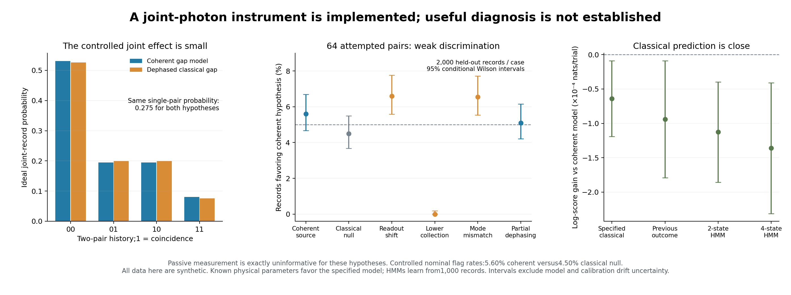

# A sequential joint-photon observation model

This extension builds the missing mathematical connection between a retained emitter environment and a two-photon HOM observation. It supplies explicit completely positive observation maps, conditional memory updates and reversible digital circuits. It changes no original QRSM, dot benchmark, experimental histogram or frozen presentation result.

The model is a **new, bounded optical-source surrogate**. It uses dispersive environmental shifts of a fully excited and fully decayed emitter, rather than the original QRSM's repeated drive/excitation-exchange step. It is not a fitted semiconductor device. The selected emitter transition returns to ground after each emission; the environmental two-level state is what persists.

## What is physically represented

For a radiative lifetime T1=1 ns and Gamma=1/T1, the fully emitted photon has amplitude

```text
phi_w(t) = sqrt(Gamma) exp(−Gamma*t/2 − i*w*t), t >= 0.
```

The environment's two basis states shift the transition by −Gamma or +Gamma in **angular frequency**, corresponding to ±Gamma/(2π) Hz. An ideal excitation/full-decay cycle maps `|excited,z,vacuum>` to `|ground,z,phi_z>`. During each wavepacket, z is fixed. Between photons, the specified gap rotation is Ry(pi/3). The competing classical model applies the same rotation and then completely dephases the environment in z. This gives the classical flip probability 1/4. The initial environment is I/2, and its conditioned state is retained throughout a record.

This is an ideal complete-emission limit. Finite pulse separation, residual excited population, environmental motion during emission, re-excitation, nonradiative loss and fast Markov photon dephasing are not modeled. In particular, this circuit does **not** reproduce all the earlier mixed-wavepacket pure-dephasing cases, whose mode space would require a separately bounded approximation. An actual dot's pulse and control compatibility remains untested.

## The circuit prepares photon states, not a final probability

Within a chosen source-control setting, there are at most four exponential wavepackets. Their complex inner products are

```text
G_ij = <phi_i|phi_j> = Gamma / [Gamma + i*(w_j − w_i)].
```

Factoring this Gram matrix embeds the entire finite family exactly in at most four orthogonal modes, encoded by two qubits per photon. The passive ±frequency family needs only two modes. Complex phases are preserved, including their effect on environmental backaction. This is not a discretized time waveform or an arbitrary rotation chosen to match a coincidence rate.

A controlled-SWAP measurement on the two emitted mode registers measures symmetric versus antisymmetric parity. Its antisymmetric outcome has the ideal balanced-HOM coincidence probability. For a correlated pair the statistic is `Tr(SWAP*rho_pair)`, not the overlap of a product of its marginals. Tracing out the photons after each outcome gives the retained-memory instrument. This is a digital representation of the observable; superconducting qubits do not become an optical beamsplitter. The measurement equivalence is established prior work. [Garcia-Escartin and Chamorro-Posada, PRA87,052330](https://arxiv.org/html/1303.6814v1)

An independent occupation-number calculation applies a literal balanced beamsplitter to bosonic creation operators. It reproduces **both** observation probabilities and conditional environmental maps, including coherences. Separate numerical integration checks the complex temporal Gram matrix.

## A useful limitation and the controlled test

With no source-frequency intervention, the coincidence effect is

```text
E_coin = 0.4*sin(theta/2)^2 I = 0.1 I  (theta=pi/3).
```

Every memory state gives the same passive coincidence probability. The specified coherent and dephased gap models therefore have identical passive record laws. Merely adding a quantum hidden state does not make it observable.

The controlled setting shifts only the second emission by a known ±Gamma. This is a hypothetical calibrated source-transition shift, not an arbitrary measurement-probability adjustment. Both models still have the same unconditional single-photon marginals under each setting. A single controlled pair also has the same coincidence probability, 0.275. Their **joint two-pair distributions** differ slightly for controls [+Gamma,−Gamma]:

| History, chronological | Coherent gap | Dephased classical gap |
|---|---:|---:|
| 00 | 0.5306250 | 0.5259375 |
| 01 | 0.1943750 | 0.1990625 |
| 10 | 0.1943750 | 0.1990625 |
| 11 | 0.0806250 | 0.0759375 |

Here 1 means the antisymmetric/HOM-coincidence outcome. These are ideal model predictions, not detector counts or a certificate of quantum memory. A broader classical process may approximate the same observations. The controlled effect is small and must survive calibration uncertainty and acquisition cost.

## Synthetic acquisition and held-out study

[PROTOCOL.md](PROTOCOL.md) fixes the study before evaluation; [INFERENCE_NUMERICS.md](INFERENCE_NUMERICS.md) fixes numerical-zero handling before the main records. Independent photon loss, imperfect optical-mode overlap and recorded bunch/coin confusion are included as CP mixtures. A third outcome records no usable pair. Accounting for both photons even when they share an output assumes reliable number-resolving detection or an equivalent pair counter. One-photon outcomes are deliberately discarded; their possible additional information is not modeled.

The completed comparison uses independent detector calibration, quantum-model training records, classical-null threshold records, and held-out nominal/nuisance cases. It compares exact physical-model likelihoods with ordinary two-state/four-state HMM predictors and a previous-outcome predictor. The HMMs have context-dependent emissions, different parameter counts, three starts and bounded local EM optimization. None is guaranteed to be the globally strongest classical model. Their reported parameter counts refer to the full three-context architecture; the passive study observes only one context. All performance intervals are conditional on one training/calibration realization and the declared synthetic physics.

The primary question is whether the specified observation channel can distinguish the chosen hypotheses. Rejection of the classical-null model would not uniquely establish coherent defects, microscopic charge traps or causal failure attribution. Controlled time- and temperature-dependent HOM spectroscopy motivates such investigations, but this is not a reproduction of its physical model or fitted device. [Thoma et al., PRL116,033601](https://arxiv.org/abs/1507.05900)

## Held-out result: this budget is not a useful discriminator

The new instrument is implemented and checked, but **64 attempted photon pairs do not provide useful discrimination in the tested regime**. There are 2,000 independent held-out records per row, with approximately 41 usable pairs per nominal record at eta=.8. The likelihood-ratio threshold was fixed from 2,000 separate classical-null records. A flag favors only the specified nominal coherent hypothesis.

| Held-out source / nuisance case | Controlled flag rate | Wilson95 interval |
|---|---:|---:|
| Nominal coherent source | 5.60% | 4.67–6.70% |
| Nominal classical source (false flags) | 4.50% | 3.68–5.50% |
| Classical source, changed readout | 6.60% | 5.59–7.77% |
| Classical source, lower collection | 0.00% | 0.00–0.19% |
| Classical source, optical mode mismatch | 6.55% | 5.55–7.72% |
| Coherent source, partial gap dephasing | 5.10% | 4.22–6.15% |

The passive classifier returns zero flags for every case because its two candidate record laws are identical. This is lack of information, **not successful fault rejection**. Lower collection also reduces evidence; its zero flag rate is not robust source diagnosis. The controlled nuisance results show that the small source-hypothesis effect is vulnerable to measurement assumptions.

Classical predictors remain close. On controlled nominal-coherent records, the calibrated physical model scores −0.976192 nats per attempted pair, the previous-outcome predictor −0.976286, the two-state HMM −0.976305 and the four-state HMM −0.976328. Their deficits are only about 0.00009–0.00014 nats per trial. Moreover, the physical model is given Gamma, delta and theta, while these classical predictors learn a more flexible description from 1,000 records. This comparison does not establish an intrinsic advantage of quantum-state modeling or a fair hardware speedup. Paired record-level intervals and all fitted HMM parameters are saved.

The independent synthetic calibration estimates e01=.0099, e10=.0211, eta=.80055 from 20,000 opportunities each. The full study contains 24,000 held-out records, 2,000 training records and 4,000 threshold-calibration records: 3.84 million attempted source excitations in total, plus 60,000 separate calibration opportunities. Those are simulated resource counts, not photons measured by this project. No optical timing, energy or monetary budget is inferred.

[Frozen results](main/results.json) · [Raw synthetic records](main/records.npz) · [Pre-run source/seed receipt](main/run_provenance.json)



The [independent review](main/independent_review.json) regenerated all 30,000 training/calibration/held-out records with a separate matrix-update sampler and checked every held-out likelihood ratio, threshold and predictor array (maximum numerical difference 5.69e−14). [Validation and artifact hashes](validation.json) record the 19 focused tests, complete replay including HMM refits, and visual inspection of the figure. These checks establish implementation consistency, not empirical validity of the optical assumptions.

The appropriate next question is whether a different, independently specified control or larger acquisition budget provides useful information per resource. Any design exploration must remain separate from these frozen records; this negative result will not be replaced by a tuned setting.

That follow-up is now available separately in [exploratory_design/](exploratory_design/README.md). A fixed exact-model scan and fresh prospective simulation found stronger nominal inference with a new control and perfect resets between four-pair blocks, but also large false flags under acquisition mismatch. A stronger eight-state classical HMM predicts about as well as the specified physical model. The follow-up preserves this original negative study and its hardware bundle; it provides conditional resource bounds and a new digital four-pair bundle, not a demonstrated defect diagnosis.

## Hardware-ready evidence and limits

Use **[hardware_bundle_v2/manifest.json](hardware_bundle_v2/manifest.json)**. It contains 14 validated circuits, source hashes, explicit classical-bit mapping, exact flag distributions and conditional environmental states. Full ideal Z distributions are in `ideal_probabilities.npz`, and measured logical circuits in `logical.qpy` use one classical register named `meas`.

- Four frozen pair-correlation controls: 5 qubits, 13 generic CX gates each.
- Passive retained-memory controls: 5/6 qubits and 13/14 CX gates.
- Controlled single pair: 7/8 qubits and 34/35 CX gates.
- Controlled two pairs: 12/15 qubits and 70/73 CX gates.
- Optional X/Y readout variants permit conditional environmental-state checks for the coherent circuits.

Counts are generic all-to-all synthesis costs, not routed backend costs or time. The ideal digital circuits exclude optical collection loss and optical detector confusion; actual QPU readout/gate errors are separate. The initial `hardware_bundle/` preserves a failed QPY readback of undecomposed Isometry instructions and is **not for submission**. Version2 stores the same validated physical circuits decomposed to ordinary u/cx gates, with successful readback equality. No IBM job is submitted by this folder's exporter or research runner.

The parent [IBM campaign](../hardware/RESULTS.md) subsequently executed the fourteen-circuit bundle and a separate four-pair selected-design bundle on real Marrakesh hardware. These are digital component measurements. In the selected four-pair coherent/dephased circuits, 4,096 shots each give raw flag-history TV errors 0.2490/0.2862, after routing to 256/334 native two-qubit gates. The declared flag/memory marginal errors are 0.2775/0.3071; these are probability-distribution distances including shot noise, not state infidelity. Conditional memory is measured in Z only. [Complete current raw-analysis provenance](../hardware/results.json) retains jobs separately. The physical optical acquisition/classification study, environmental reset and real semiconductor source have not been replicated by these component circuits.

## Reproduce

From the repository root in the development environment:

```bash
python -m unittest discover -s quantum_dot_bridge/qrsm_hom_followup -p "test_*.py" -v
python quantum_dot_bridge/qrsm_hom_followup/export_hardware.py --output-dir /path/to/fresh-bundle
python quantum_dot_bridge/qrsm_hom_followup/run_research.py --output-dir /path/to/fresh-study
python quantum_dot_bridge/qrsm_hom_followup/verify_results.py --refit
python quantum_dot_bridge/qrsm_hom_followup/plot_results.py
```

Both exporters refuse existing output directories. The study uses NumPy/SciPy for exact small density matrices and classical inference; Qiskit verifies the coherent digital circuits. Dense statevector checks are capped at 15 qubits. The direct memory recursion uses a 2×2 density matrix and is a strong efficient classical reference. This extension implements a missing observation model; it establishes no computational speedup, physical-dot diagnosis or lithography compatibility.
