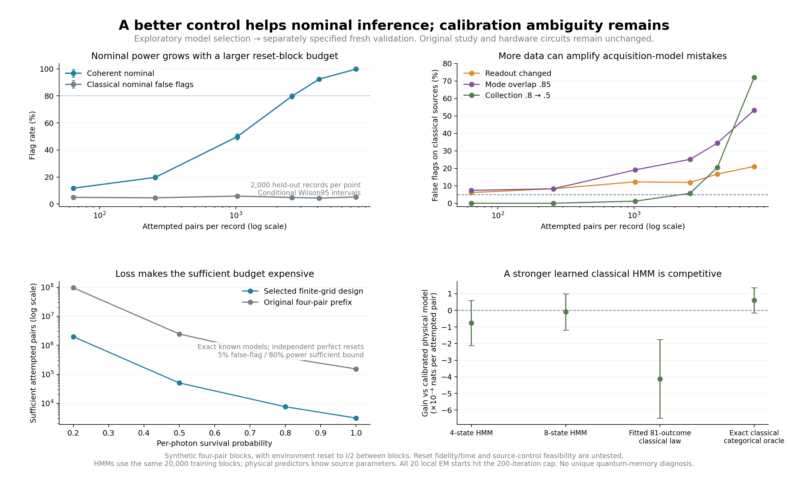

# Can a better control design overcome the weak signal?

This is a **separate, exploratory design and prospective simulation**, performed after the original 64-pair study returned weak discrimination. It preserves that negative result and all fourteen original hardware circuits. It uses only the existing exact optical-source model; no measured quantum-dot record is fitted or used to optimize a control.

The experiment is now a four-pair block. The environmental state is retained within the block, then ideally reset to I/2 before the next block. That reset is a substantial new preparation assumption. Its time, fidelity and implementation in a dot are not demonstrated. There is no conversion from radiative lifetime to an asserted acquisition time.

## Exact design result

[The saved exploration protocol](PROTOCOL.md) specifies 648 combinations of gap rotation, source-frequency shift and four-pair pattern. Every setting and both complete 81-outcome distributions are retained in [design_results.json](design_results.json). Selection uses exact distributions, not sampled validation data. A four-pair record has three outcomes per pair: no usable pair, bunch, or coincidence.

The selected grid point has gap angle **3π/4**, and shifts the second photon in each pair by **+2Γ in angular frequency**, with Γ=1/T1. At T1=1 ns the shift corresponds to about 318 MHz. This shift changes the actual modeled exponential wavepacket, through its complex overlap with all the other modes. It is not a final-output probability setting. No global optimum outside the finite grid is claimed.

At nominal photon survival eta=.8 and specified readout confusion, the selected four-pair laws have total variation 0.03724 and Bhattacharyya information 0.0012054 nats per block. That is 49.06 times the information of the original [0,+Γ,−Γ,0] four-pair prefix with theta=π/3, evaluated under the **same independent-block assumption**. It is not a 49-fold improvement in real-device performance or in the earlier continuously retained 64-pair test. Single-pair distributions remain equal between the hypotheses; the signal comes from joint outcomes.

## Required data and loss sensitivity

For independent blocks, a likelihood-ratio threshold of log4 has rigorous bounds on false flags and missed detections based on the exact coefficient B=sum sqrt(P_Q P_C). If B^n<=0.1, false flags are at most 5% and power at least 80% for the two known nominal laws. The bound is **sufficient, not necessary**. It assumes perfect resets and exactly known calibration; it does not include nuisance drift, model misspecification or an arbitrary classical alternative.

| Per-photon survival | Sufficient independent blocks | Attempted pairs | Normal approximation, blocks |
|---|---:|---:|---:|
| 1.0, with nominal confusion | 779 | 3,116 | 263 |
| 0.8, with nominal confusion | 1,911 | 7,644 | 646 |
| 0.5, with nominal confusion | 12,627 | 50,508 | 4,278 |
| 0.2, with nominal confusion | 496,094 | 1,984,376 | 168,387 |

The normal estimates are approximations based on exact likelihood-ratio moments. They have no finite-sample guarantee. An ideal lossless, confusion-free detector gives a sufficient 675 blocks. These budgets include lost pairs; each pair costs two modeled excitation/emission cycles. Reset/control overhead and unmodeled preparation failures can only add resource requirements. No experimental source brightness, operating rate, energy or hardware speedup follows from these numbers.

## Fresh validation and classical controls

[VALIDATION_PROTOCOL.md](VALIDATION_PROTOCOL.md) was saved before sampling the new validation records. Its six budgets are 16, 64, 256, 646, 1024 and 1911 independent blocks. It fixes independent detector calibration, independent null thresholds at each budget, and seven nominal/nuisance cases. All budget/case outcomes are reported, with intervals conditional on this one calibration and model. Calibration of a classical-null reference is supplied synthetically; obtaining a trusted reference experimentally is an additional requirement.

Four-state and eight-state HMMs receive the same 20,000 training blocks, ten starts each, tighter tolerance and 200-iteration caps. An unrestricted 81-outcome categorical predictor learns the complete four-pair law from those same observations. An exact classical categorical oracle has the identical joint probability law as the physical model by construction. This prevents a successful simple-hypothesis test from being misrepresented as certification of quantum memory or a classical-computation impossibility.

Physical predictors know the specified source parameters; fitted HMMs do not. Data are shared across learned controls, but parameter counts and computation differ. Local EM is not a proof of global optimality. The separate predictive holdout contains 20,000 blocks. Raw block records, multinomial counts, all start scores, predictions, seeds and source hashes are saved.

## What the fresh validation learned

The nominal model can become distinguishable with more attempts and the new control/reset assumptions. However, **larger data do not resolve calibration-model ambiguity**, and a learned classical HMM remains competitive.

| Attempted pairs per record | Coherent nominal flags | Classical nominal false flags |
|---|---:|---:|
| 64 | 11.70% | 4.95% |
| 256 | 19.70% | 4.60% |
| 1,024 | 49.80% | 5.90% |
| 2,584 | 79.75% | 4.85% |
| 4,096 | 92.40% | 4.40% |
| 7,644 | 99.80% | 5.20% |

Every cell has 2,000 independent held-out records. At 2,584 pairs, the conditional Wilson95 intervals are 77.93–81.45% for nominal detection and 3.99–5.88% for nominal false flags. The entire curve is retained; these are not six independent attempts to select a favorable significance result. At the rigorous budget of 7,644 pairs, the separate exactly known-model/log4 test gives 96.55% detection and 0.65% false flags, consistent with its conservative 80%/5% bound. That fixed-threshold calculation is distinct from the finite-calibration curves above.

Nuisance controls expose the major limitation. At 7,644 pairs, a still-classical source with changed readout is flagged **21.05%** of the time; mode overlap reduced to .85 gives **53.25%**; collection reduced from .8 to .5 gives **72.00%**. At this budget the calibrated nominal-null threshold is negative. A lossier record contains less evidence against the coherent candidate, so it can exceed that nominal threshold even without coherent dynamics. This is a failure of the two-model decision rule under acquisition mismatch, not evidence that loss causes quantum memory. Additional calibration, explicit nuisance alternatives and trusted controls are needed before source attribution.

On the separate predictive blocks, the eight-state HMM scores only **0.0000092 nats per attempted pair below** the calibrated physical model; its paired gain interval is [−0.0001185,+0.0001000], which includes zero. The four-state HMM's corresponding interval also includes zero. Both use the same training data as the categorical control. Every one of the twenty EM starts reached the 200-iteration cap, so global convergence is not asserted. The unrestricted fitted categorical predictor is less data efficient in this finite training sample; its exact oracle reproduces the physical law. There is no demonstrated predictive advantage over the learned eight-state HMM and no certification against general classical memory.

The fresh calibration is e01=.01015, e10=.01905, eta=.80325 from 20,000 opportunities each. Across all budgets, null thresholds, seven counterfactual cases and predictor records, the study represents **501,696,000 simulated source excitations**, plus 60,000 calibration opportunities. This large aggregate is sampled efficiently as exact finite-block count vectors; it is not an optical dataset acquired by the team. Source control/reset costs are additional. The run took about 58 seconds locally because the physical model is small and the independent-block distributions are known.

[Prospective results](validation_run/results.json) · [Raw block/count data](validation_run/records.npz) · [Source/seed receipt](validation_run/provenance.json)

The [independent review](validation_run/independent_review.json) used separate bosonic map propagation and explicit HMM forward scoring. It replayed 40,000 training/prediction blocks, all 96,000 power-calibration/held-out count vectors, the six thresholds and all 42 source/nuisance cases. The largest numerical discrepancy was 3.09e−13. The reviewer's [portable independent checker](independent_validation_check.py) preserves that calculation, changing only path and optional receipt-output handling. [Validation receipt](validation_receipt.json) records tests, hashes and artifact checks. Numerical agreement does not validate the ideal reset or optical source assumptions.



The useful endpoint is a control-dependent viability bound and an explicit failure mode. The next empirical requirement is independently calibrated optical collection/overlap and a source preparation/control model, followed by nuisance-aware inference. Neither the original negative study nor these conditional improvements identify defects in a real dot.

## Separate four-pair hardware bundle

[hardware_bundle/manifest.json](hardware_bundle/manifest.json) contains the selected coherent/dephased four-pair circuits (22/29 qubits, 145/152 generic CX gates) and passive controls (14/21 qubits, 49/56 generic CX gates). [HARDWARE_EXTENSION.md](HARDWARE_EXTENSION.md) specifies the interface and limitations. The whole photon preparation and joint readout is encoded; no final coincidence probability is loaded directly.

Exact 32-entry flag/memory marginals and all ideal conditional memory matrices are saved. Aer MPS validation with truncation threshold 1e−16 and no bond cap agrees with CP-map propagation to at most 2.70e−11 in marginal probabilities. Three additional tests check register accounting, MPS marginal ordering and agreement with the original one-/two-pair circuits. An [independent serialized-QPY replay](hardware_bundle/independent_review.json) reproduces all four marginals. Memory hardware readout is Z only, so the ideal matrices are not complete empirical tomography. QPY readback passes.

These are generic all-to-all gate counts before backend routing. The circuits omit optical loss/readout confusion; actual superconducting gate/readout errors are separate. A four-pair digital experiment does not reproduce the full optical acquisition classifier, its calibrated nuisance controls or thousands of environmental resets. Hardware jobs and measured results belong to the separate parent campaign; this exporter submits nothing and claims no particular hardware outcome.

The parent campaign subsequently executed all four circuits on IBM Marrakesh, at 4,096 shots each. The [campaign results](../../hardware/results.json) retain the actual compiled plans, immutable counts and source hashes:

| Four-pair component | Logical qubits | Compiled native two-qubit gates | Raw flag-history TV | Raw declared flag/memory TV |
|---|---:|---:|---:|---:|
| Selected coherent | 22 | 256 | 0.2490 | 0.2775 |
| Selected dephased | 29 | 334 | 0.2862 | 0.3071 |
| Passive coherent control | 14 | 77 | 0.0238 | 0.0535 |
| Passive dephased control | 21 | 129 | 0.0439 | 0.0554 |

The deeper selected-design circuits have substantial distribution error in this execution. A hardware difference between programmed models is not proof of coherent defects in a semiconductor. All TV values include sampling noise; the wider circuits have only the declared marginal reference, and Z-conditioned memory is not complete tomography. These measured component results do not change the conditional synthetic power curve or its nuisance failures.

## Reproduce

```bash
python -m unittest discover -s quantum_dot_bridge/qrsm_hom_followup/exploratory_design -p "test_*.py" -v
python quantum_dot_bridge/qrsm_hom_followup/exploratory_design/run_design.py --output /fresh/location/design_results.json
python quantum_dot_bridge/qrsm_hom_followup/exploratory_design/run_validation.py --output-dir /fresh/location/validation_run
python quantum_dot_bridge/qrsm_hom_followup/exploratory_design/verify_exploration.py
python quantum_dot_bridge/qrsm_hom_followup/exploratory_design/independent_validation_check.py
python quantum_dot_bridge/qrsm_hom_followup/exploratory_design/export_selected_hardware.py --output-dir /fresh/location/hardware_bundle
python quantum_dot_bridge/qrsm_hom_followup/exploratory_design/plot_validation.py
```

Both runners refuse existing outputs. The validation runner reads the canonical frozen design-results hash and does not automatically use an arbitrary alternate scan output. The verifier replays every exact design, all fresh random records and all stored predictions; `--refit` additionally repeats twenty HMM fits. This is a small exact density-matrix/finite-distribution calculation on a classical computer. No cloud or laboratory submission is performed by these scripts.
