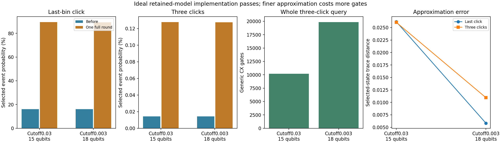
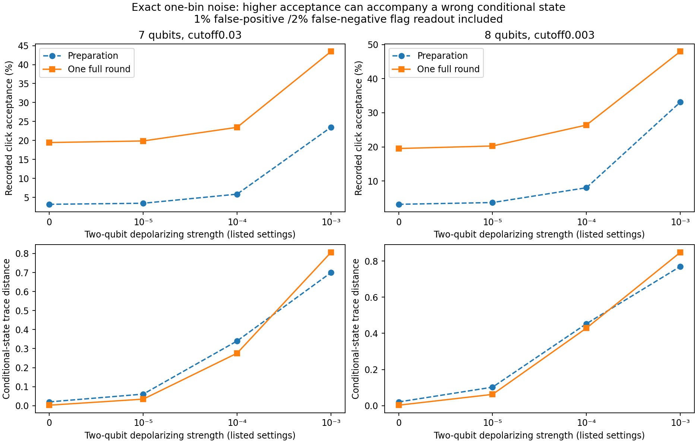

# Three-bin coherent queries and exact small-circuit noise

The retained optical model now works coherently through **three time bins**, with every history and conditional system state checked against direct channel propagation. A finer approximation improves the tested conditional states but roughly doubles generic gate cost. The separate one-bin noise calculation shows why acceptance alone is insufficient: gate errors can produce more recorded clicks while making the conditional state very wrong.

This is a local simulation and compilation study. It uses neither an IBM API nor optical hardware. Existing two-bin, sensor, inference, finals and application files are unchanged.

## Three-bin result

The physical model is the original **cavity-dimension-2** emitter–defect–cavity instrument. Its three system qubits start in the all-zero state. Each bin receives a fresh coherent outcome flag and environment; all are retained for reversal. The original model's rates/frequencies use consistent arbitrary units and its bin duration is 1 in those units, not a calibrated laser sampling period.

Each outcome map is Choi-truncated, and the combined Kraus operators are right-normalized to obtain a trace-preserving approximation. The two retained approximations use 7/4 and 14/8 no-click/click Kraus components. They require three or four environment qubits **per bin**, respectively, plus one outcome flag per bin.

| Absolute Choi cutoff | Three-bin qubits | Whole last-click query CX/depth | Whole three-click query CX/depth |
|---|---:|---:|---:|
| 0.03 | 15 | 10,183 /18,985 | 10,189 /18,992 |
| 0.003 | 18 | 19,858 /37,611 | 19,864 /37,618 |

Counts include preparation, predicate marking, inverse preparation, reflection about the **full** all-zero input, and replay, compiled to generic all-to-all `u,cx` with optimization level 1 and seed 13. They exclude device routing, calibration, measurement, repetitions, error correction and physical source preparation. They are not hardware time or universal synthesis lower bounds. The original project's approximate local reflection is not used in this follow-up.

| Query and cutoff | Retained probability before | Probability after one full round | Conditional-state error versus original cavity-2 model |
|---|---:|---:|---:|
| Last-bin click,0.03 | 16.1537% | 89.5014% | 0.02616 |
| Last-bin click,0.003 | 16.0788% | 89.3134% | 0.005826 |
| Click in all three bins,0.03 | 0.0142091% | 0.1278333% | 0.02604 |
| Click in all three bins,0.003 | 0.0141777% | 0.1275509% | 0.01094 |

The original **cavity-2 maps before Choi truncation** give probabilities of 16.1445% for last-bin click and 0.0147042% for three clicks. These are different from both the original discrete QRSM's step-three event and the optical companion's earlier two-bin event.

The largest circuit-versus-retained-model implementation error across the checked branches, probabilities, selected mixtures and conditional states is below **6.3×10⁻¹³**. Full amplification preserves the retained conditional result; it does not repair approximation error against the original instrument. All eight history branches were checked, not only the selected event. Saved NPZ archives retain the unnormalized system matrices from original maps, retained maps, compiled preparation, and both amplified circuits.

Lowering the cutoff improves the largest tested conditional-state error from 0.02831 to 0.01121 and the complete history-probability TVD from 0.001898 to 0.001812. **Individual probability errors need not improve monotonically:** the three-click probability is slightly farther from the original at the finer cutoff. Right-normalization redistributes discarded weight. None of these sampled-input errors is a diamond-norm bound, proof of continuum-cavity convergence, or validation of a physical source. The separate `../followup/` cavity-convergence study addresses another approximation layer; this construction deliberately remains cavity dimension 2.



## Strong classical comparisons

For these queries, classical inference does not need rejection sampling—or even enumeration of every history. Let E0,E1 be the two outcome maps and E=E0+E1. Starting from rho0:

- Last-bin click: unnormalized selected state is `E1 E^(B−1) rho0`.
- All B clicks: unnormalized selected state is `E1^B rho0`.

Their traces give event probability, and normalization gives the numerical conditional density matrix. This takes B channel applications at fixed system dimension. In the implemented dense representation, each application is a 64×64 matrix-vector product. On this computer, three-bin event-specific recursion took roughly 15–23 microseconds at the coarse cutoff over 21 timed repetitions. Computing all eight branches took about 46 microseconds. These timings exclude construction of the known instrument; that setup is also needed by the quantum synthesis. Exact timings and ranges are saved for both cutoffs.

For the last-click event, 100,000 conditional histories were sampled directly from four exact conditional probabilities, without rejection; the empirical TVD was about 0.00105 at the coarse cutoff. For all-three-click conditioning, the only possible observed history is 111, so history sampling itself is trivial. The associated conditional system state is still a nontrivial calculated density matrix.

The quantum statevector simulations took roughly 1.8 s per amplified 15-qubit query and 20 s per 18-qubit query on this CPU. **Those are classical simulator runtimes, not QPU runtimes.** They must not be used as a quantum-hardware speed comparison. The direct classical method already answers the small numerical inference questions efficiently. A classical matrix calculation does not physically prepare an arbitrary quantum state; that is a distinct task with different resources. No useful computational crossover is demonstrated here.

## Noise changes the answer, not just acceptance

The noisy study is deliberately limited to **one bin**, using 7 or 8 qubits. Its preparation circuits have 1,051 or 2,086 CX gates; one full amplification round has 3,269 or 6,422. Exact density matrices average the declared noise channels, so the reported values have no Monte Carlo shot error.

After every CX gate, apply local two-qubit depolarization strength λ; after every `u` gate, apply single-qubit strength λ/10. Four settings are tested: 0, 10⁻⁵, 10⁻⁴, 10⁻³. The [Aer definition](https://qiskit.github.io/qiskit-aer/stubs/qiskit_aer.noise.depolarizing_error.html) is `E(rho)=(1−λ)rho+λ Tr(rho) I/2^n` on the affected qubits. **λ is that channel parameter**, not a measured IBM error rate, total circuit failure probability or average gate infidelity. There is no routing, idle relaxation, crosstalk or calibrated device noise.

The final outcome flag has asymmetric readout errors: 1% for 0→1 and 2% for 1→0. If R0,R1 are the true unnormalized system branches, a recorded click conditions on

`R_recorded1 = 0.01 R0 + 0.98 R1`.

Both its trace and its normalized density matrix are checked. Only changing the acceptance probability would miss the state contamination from false flags.

| One-bin amplified circuit | CX depolarizationλ | Recorded acceptance | Conditional-state trace distance from retained target |
|---|---:|---:|---:|
| 7 qubits | 0; readout errors only | 19.45% | 0.00272 |
| 7 qubits | 10⁻⁵ | 19.87% | 0.03450 |
| 7 qubits | 10⁻⁴ | 23.46% | 0.27594 |
| 7 qubits | 10⁻³ | 43.45% | 0.80582 |
| 8 qubits | 0; readout errors only | 19.54% | 0.00281 |
| 8 qubits | 10⁻⁵ | 20.27% | 0.06251 |
| 8 qubits | 10⁻⁴ | 26.41% | 0.42879 |
| 8 qubits | 10⁻³ | 47.96% | 0.84755 |

The 7-qubit ideal acceptance before readout is 19.03%. Its rise to 43.45% under stronger gate noise is therefore **not successful amplification of the right answer**: the conditioned state has trace distance 0.806 from its target. The finer 8-qubit approximation suffers more generic gate noise because its synthesized circuit is deeper. These particular decompositions and error channels do not establish an optimal hardware tradeoff.

With ideal gates, amplification can reduce readout contamination: false true-flag-0 events account for 30.75% of recorded clicks in the 7-qubit preparation case versus 4.16% after amplification. At low chosen gate error the amplified conditional state also remains closer than the preparation's readout-conditioned state. At the largest chosen error, added depth dominates and amplification gives the worse conditional state. All results are retained; there is no claim that amplification always improves or always worsens noisy inference.



This is mathematical conditioning on simulated density matrices. No actual hidden-state tomography or experimental fidelity measurement was performed. No 15/18-qubit noisy query was simulated, so the one-bin values cannot be quoted as noise performance of the three-bin algorithm.

## Register growth and execution limits

For this generic purification, `qubits = 3 + B × (1 + environment_bits)`: 3+4B at cutoff 0.03 and 3+5B at 0.003. Qubit count is linear in bins; dense classical simulator storage is exponential in that count. This does not imply an exponential advantage over event-specific classical inference. More structured dilations, compression, alternative oracles and decompositions may change resources.

A 15-qubit dense density matrix alone would require 16 GiB and an 18-qubit matrix 1 TiB. This study avoided both. Each worker had an enforced 2,048 MiB process memory limit and 240 s wall-time limit. All four cases finished, with no timeout or abandoned job; the longest cases took about 52 s each. Larger register entries in the JSON are storage arithmetic only, not simulations or hardware estimates.

## Reproduce and validate

The checked environment was Python 3.12.10, NumPy 2.3.1, SciPy 1.18.1, Qiskit 2.6.1 and Aer 0.18.2. NumPy/SciPy/Qiskit/Aer and Matplotlib are required; Windows execution also needs pywin32 to enforce the process memory cap. A reproduction should use a virtual environment and a fresh output directory.

```powershell
$env:OPENBLAS_NUM_THREADS='1'
$env:OMP_NUM_THREADS='1'
python -m unittest discover -s qrsm_photon_poc/multibin_followup -p test_model.py -v
python qrsm_photon_poc/multibin_followup/run_suite.py --out qrsm_photon_poc/multibin_followup/reproduction
python qrsm_photon_poc/multibin_followup/validate_and_plot.py --run qrsm_photon_poc/multibin_followup/reproduction
```

Seven tests use an independent analytically solvable three-bin instrument, verify all branches and coherent states, full amplification, event recursion, complex partial traces, readout mixtures, depolarization and width guards. A separate saved-matrix audit checks source/archive hashes, positivity and normalization, original channel propagation, SVD trace distances and readout conditioning. All 10 grouped validation checks passed. An independent reviewer additionally rebuilt the retained maps through Qiskit's Choi-to-Kraus conversion and separate right-normalization, checked all 144 saved branch matrices and repeated the seven tests; the largest discrepancy was 6.24×10⁻¹³. The figures were visually inspected.

`PROTOCOL.md` and source/version hashes were recorded in `main/provenance_start.json` before the four cases ran. The runner refuses reused output directories and preserves failures. JSON summaries and NPZ branch matrices permit independent numerical review without rerunning compilation.

The useful next work is structure-aware synthesis and a task whose conditional answer is classically difficult at a physically justified model size. Better Choi approximation alone is not enough: it can increase depth before a noise-tolerant implementation exists. IBM hardware could eventually test a shortened, mapped candidate, but an API key is unnecessary for the present checks and would not solve the current gate-cost problem.
