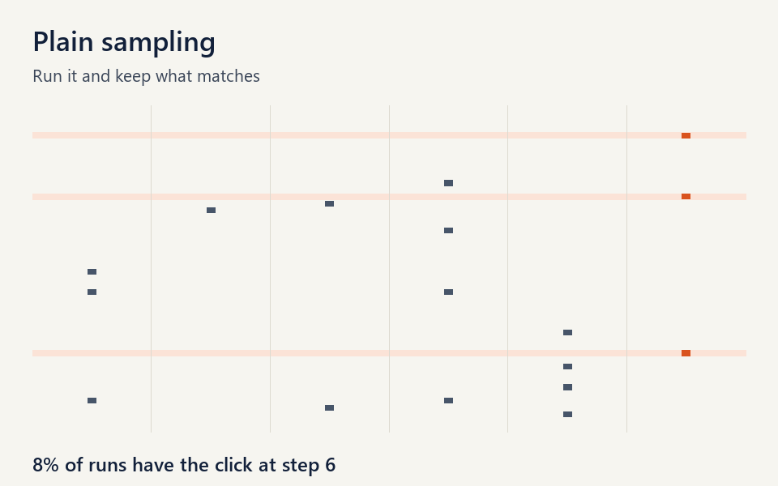
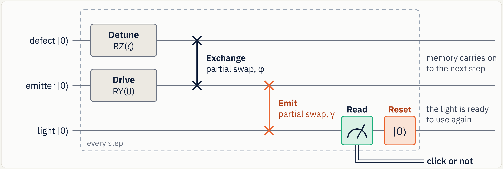
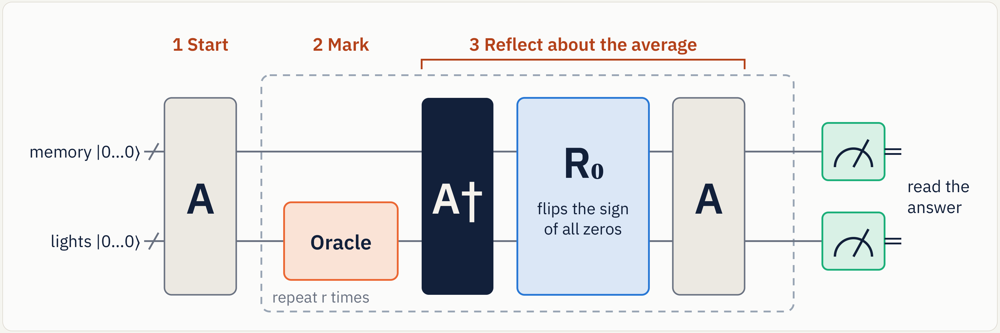
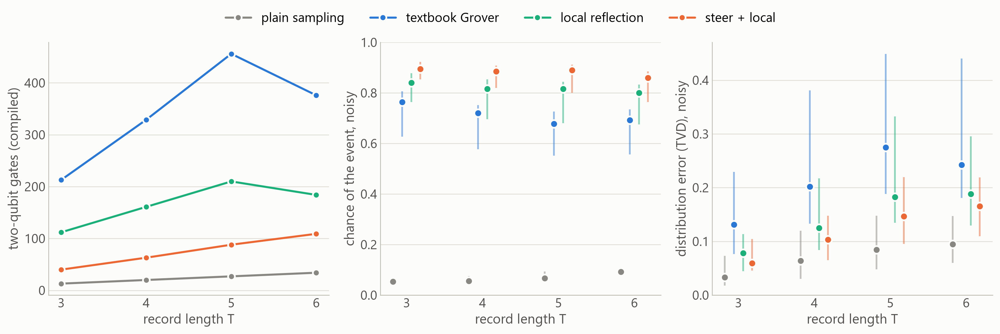
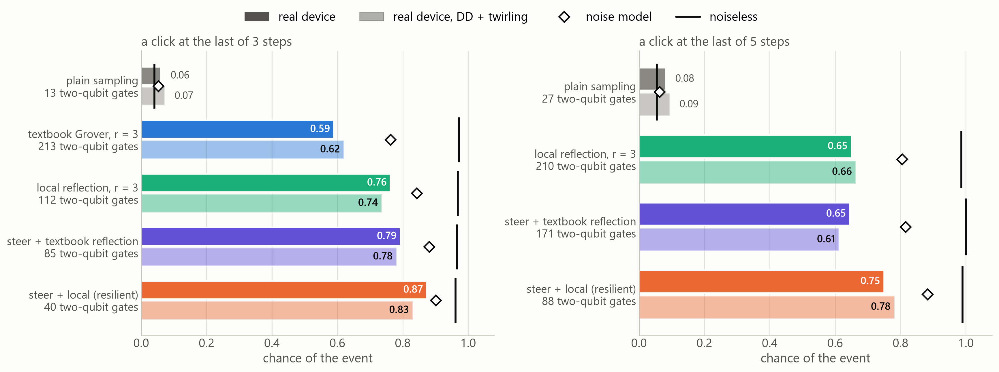

# Rewind & Amplify

**Grover's algorithm inside a quantum recurrent state machine, redesigned around noise.**

FGCU Quantum Hackathon, IBM Qiskit Fall Fest, November 2026.

[](https://github.com/Nicholas55555/rewindandamplify/actions/workflows/tests.yml)

**[Slides](deck/Rewind_and_Amplify_deck.pdf) · [Report](docs/REPORT.md) · [One page](docs/ONE_PAGER.md) · [Notebook](notebooks/walkthrough.ipynb) · [Team guide](docs/TEAM_GUIDE.md) · [Lab demo video](demo/Rewind_and_Amplify_lab_demo.mp4)**



*Each row is one run of the machine, and each tick is a click. The orange column is a rare click we asked about.*

## The idea in a minute

The most useful events in a quantum system are often rare. Our model, a **quantum recurrent state machine (QRSM)**, is a small circuit that behaves like a recurrent network: hidden qubits hold the memory, and one bit comes out per step, click or no click. To ask it "what happens around this rare event?", you have to run it and throw away every run that doesn't match. Matching one real 64-step record takes about **27 million runs**.

Grover's algorithm makes rare answers common at about the square root of the cost. But it has to run the machine backwards, and a QRSM resets a qubit every step. A reset can't be undone. **You can't Grover what you can't rewind.** And Grover is deep, so noise punishes it.

So we built this in four moves:

| move | what it does | what it buys |
|---|---|---|
| **1. Purify** | a fresh qubit replaces every reset | one reversible circuit, holding every click history at once with weight √P(history) |
| **2. Steer** | tune one gate so the event is common | removes part of the rarity for free, with conditional answers still exact |
| **3. Amplify locally** | one iteration, with a reflection on 3 qubits instead of all of them | far fewer gates, so far less noise |
| **4. Verify** | the event is measured directly | a failed shot shows itself and is dropped |

## The two circuits

**One step of the hybrid QRSM.** The emitter and the defect are the memory, and they're never measured. The light is read and reset, so information leaves and the memory can forget.



**Grover's algorithm.** A prepares every answer at once, and in our case A is the whole machine. Each iteration marks the matches, rewinds with A†, reflects, and replays. That A† is why a machine that resets can't be used directly. The resilient build keeps this shape, with one angle changed in A and a 3-qubit R₀.



## What we found

| finding | result |
|---|---|
| **Purifying changes nothing** | amplitudes match the exact model to 4 × 10^-16; reset and purified circuits click alike over 1,000,000 shots each (p = 0.61) |
| **Grover conditions exactly** | real Qiskit circuits follow theory within 8 × 10^-15, and conditional distributions and hidden states stay exact |
| **The wall falls** | one real 64-step record: 27,495,891 runs, 6,240 steered, 125 calls with Grover on top. Steering gives about 4,400 times of that, Grover about 50 |
| **Resilient beats textbook under noise** | on five IBM device snapshots: 3 to 5 times fewer two-qubit gates, a chance of the event of 0.88 against 0.71, and distribution error 0.12 against 0.21 |
| **It held up on real IBM chips** | on ibm_kingston, steer + local hit a rare event 0.87 of the time on 40 two-qubit gates, against 0.59 for textbook Grover on 213, and won all 20 comparisons across five jobs. [Details](#real-hardware) |
| **It answers a physics question** | what follows a rare click tells a hidden defect from none. At 4,096 noisy shots the separation goes from 2.4 to 7.1 standard errors |
| **A QRSM can be the oracle too** | a reader QRSM found the right table for 19 of 20 vague requests. There is no speedup: 1,024 entries take 32,800 gates against a 1,024-step scan |



**What we don't claim.** There is no speedup today: at this size an exact classical sampler gives a sample in about a millisecond. Most results here are simulation, including the IBM noise models, and the [real-chip runs](#real-hardware) are small: at most 11 qubits and 5 steps. We rewind a *model* of a chip, never a chip: a physical defect can't be run backwards. Steering is classical importance sampling. The local reflection is an approximation that drifts on long records. Amplified rejection sampling is a known idea ([Low, Yoder & Chuang 2014](https://doi.org/10.1103/PhysRevA.89.062315)): what's ours is the mapping onto hidden quantum models, and the resilience work.

**Why it could still matter.** The classical sampler's cost grew about 6 times per hidden qubit in our tests. IBM's [published 2029 target](https://www.ibm.com/quantum-computing/roadmap), 200 logical qubits and 100 million gates, would by our rough estimate fit a QRSM with 50 hidden qubits and a 150-step record, whose memory alone would take about 18 petabytes classically. That's an estimate, not a result.

The full story, including what we got wrong, is in the [report](docs/REPORT.md). For a plain-English version, see the [one-pager](docs/ONE_PAGER.md).

## Try it

Python 3.10 or later. No account needed.

```bash
git clone https://github.com/Nicholas55555/rewindandamplify.git
cd rewindandamplify
pip install -r requirements.txt
python demo/demo.py          # the one-minute demo: real circuits on Aer
pytest                       # 114 tests
```

- **[notebooks/walkthrough.ipynb](notebooks/walkthrough.ipynb)** walks through the idea in a dozen cells, with outputs saved.
- **`demo/index.html`** is an interactive lab. Open it in a browser: no server needed.
- `python demo/demo.py --noisy FakeFez` runs the demo on an IBM device's noise model.
- `python demo/demo.py --query "chip errors at readout"` tries your own vague search.

## Using it

```python
from qrsm_grover import QRSM, click_at
from qrsm_grover.amplify import hardware_amplified, steered_gamma
from qrsm_grover.fastsim import reflection_qubits

machine = QRSM()                      # an emitter, one hidden defect, and a light
T = 6
question = click_at(T)                # "a click at step 6"

p = machine.history_probabilities(T)[question.mask(T)].sum()
steer = steered_gamma(p, machine.gamma)                 # tune the last emission so p' = 1/4
A = machine.purified(T, gammas=[None] * (T - 1) + [steer])

n = machine.n_memory
oracle = question.oracle(n + T, list(range(n, n + T)))
circuit = hardware_amplified(A, oracle, r=1, reflect_on=reflection_qubits(machine, T, "memory+last-1"))
```

## Real hardware

**It ran on real IBM chips.** On 5 November 2026 we ran the 39 circuits on ibm_kingston and ibm_marrakesh, two 156-qubit Heron chips: seven jobs, 337 seconds of device time on the free plan, and at most 11 qubits per circuit. Our predictions went into git before the first job, and scored 12 held, 3 partly, 1 missed.



- **Fewer gates won.** On Kingston, steer + local won 20 of 20 comparisons across five jobs. At T = 3 it hit the event 0.87 of the time on 40 two-qubit gates, against 0.59 for textbook Grover on 213, with a distribution error of 0.06 against 0.26. A repeat gave 0.88 and 0.55.
- **Depth costs more than the noise model says,** about 3 times more per gate. So the lead came out about twice what simulation predicted.
- **Suppression did little.** Textbook Grover at its best, with DD, reached 0.63. Steer + local got more with none.
- **The after-click fingerprint came through,** at 5.7 and 6.8 standard errors on Kingston and 6.6 on Marrakesh, where plain sampling never passed 2. It's fragile: DD erased it, which we got wrong in advance.
- **Calibration hid a bad patch.** On Marrakesh, the qubits that looked best did far worse than the others we used. Our echo circuits caught it, and moving off them recovered the result. That job is a post-hoc test, and we label it so.

Job IDs, every table and the noise analysis are in [section 13 of the report](docs/REPORT.md#13-real-hardware). The raw counts and the exact compiled circuits are in [`results/hardware/`](results/hardware/).

To run it on your own IBM Quantum account:

```bash
python tools/save_ibm_account.py          # your key goes in at a hidden prompt, and stays in ~/.qiskit
python experiments/run_ibm.py --plan      # compiles everything and estimates QPU time; uses none
python experiments/run_ibm.py --predict   # simulates those exact circuits with the device's noise model; uses none
python experiments/run_ibm.py --submit    # sends both jobs
python experiments/run_ibm.py --fetch
python experiments/analyse_hardware.py
python experiments/make_figures.py
```

## How it's organised

```
qrsm_grover/        the package
  model.py            the QRSM: dynamic, purified and exact Kraus forms
  predicates.py       questions about a history, and their oracles, including the recurrent reader
  amplify.py          Grover, steering, and hardware-minded reflections
  classical.py        the classical baselines, including an exact backward sampler
  fastsim.py          a fast exact simulator for long records and any reflection
  queries.py          Grover inside the recurrent loop: what happens after a rare click
  search.py           the keyword search: a reader QRSM as the oracle
  hardware.py         the hardware job, compiling and readout correction
experiments/        one script per experiment, each writing to results/
results/            every result, numbers.json with the headline figures, and the charts
tests/              114 tests, with pass marks that follow from theory
demo/               the one-minute demo and the interactive lab
notebooks/          a walkthrough, with outputs saved
docs/               the report, the one-pager, the team guide and the design log
deck/               the slides as HTML, a PDF, a PowerPoint with speaker notes, and a speaker script
tools/              IBM account set-up, and the builders for the deck, video and documents
prior_work/         the hidden-defect project this builds on
```

To rerun everything, from the top: `e1_purify.py`, `e2_amplify.py`, `e3_scaling.py`, `e4_reflection.py --noiseless`, `e4_reflection.py --noisy NAME`, `e4b_local.py`, `e5_inside_loop.py`, `e6_catalog.py`, `e7_resilience.py`, then `summarise.py` and `make_figures.py`. The noisy runs on five device snapshots take about an hour on a laptop. Every script takes `--quick`.

**We logged our predictions before each run.** [docs/design_log.md](docs/design_log.md) has the plan, what we expected, what we saw, and what we got wrong, in time order. That includes the flaw in our first reflection, and the pilots that shaped the design.

## Prior work and AI help

Disclosed, as the event's rules allow.

- **Before the event (October 2026):** the QRSM idea, the physics-shaped model and its exact filter.
- **During the event, earlier in the week:** the QRSM as a Qiskit dynamic circuit, click records from a noisy IBM device model, and the head-to-head with an LSTM. See [prior_work/hidden_defects](prior_work/hidden_defects/README.md).
- **During the event, this repository:** the Grover fusion, purification, steering, the local reflection and its leak diagnostic, the reader oracle, and every experiment here.
- **AI assistance:** this work was built with Claude. The team set the direction and the research questions, and reviewed the results.

## Team

- **Nicholas Taylor**: QRSM research, the Grover fusion, experiments
- **Timofey Yudintsev**: research, and the keyword search idea
- **Dan Izquierdo**: experimentation
- **Dillon Satria Sitepu**: formatting and revising

## References

- L. K. Grover, "A fast quantum mechanical algorithm for database search", STOC 1996.
- G. Brassard, P. Høyer, M. Mosca and A. Tapp, "Quantum amplitude amplification and estimation", Contemporary Mathematics 305 (2002).
- M. Boyer, G. Brassard, P. Høyer and A. Tapp, "Tight bounds on quantum searching", Fortschritte der Physik 46 (1998).
- G. H. Low, T. J. Yoder and I. L. Chuang, "Quantum inference on Bayesian networks", [Phys. Rev. A 89, 062315 (2014)](https://doi.org/10.1103/PhysRevA.89.062315).
- C. Blank, D. K. Park and F. Petruccione, "Quantum-enhanced analysis of discrete stochastic processes", [npj Quantum Information 7, 126 (2021)](https://doi.org/10.1038/s41534-021-00459-2).
- F. Ghafari et al., "Interfering trajectories in experimental quantum-enhanced stochastic simulation", [Nature Communications 10 (2019)](https://doi.org/10.1038/s41467-019-08951-2).
- A. Monras, A. Beige and K. Wiesner, "Hidden quantum Markov models and non-adaptive read-out of many-body states", [Applied Mathematical and Computational Sciences 3 (2011)](https://arxiv.org/abs/1002.2337).
- K. Zhang and V. E. Korepin, "Depth optimization of quantum search algorithms beyond Grover's algorithm", [Phys. Rev. A 101, 032346 (2020)](https://doi.org/10.1103/PhysRevA.101.032346).

## License

MIT. See [LICENSE](LICENSE).
