# Rewind & Amplify: the report

**FGCU Quantum Hackathon, IBM Qiskit Fall Fest, November 2026.** For a plain-English version, see the [one-pager](ONE_PAGER.md). For the order things happened in, and what was predicted before each run, see the [design log](design_log.md). Every number below is in [`results/numbers.json`](../results/numbers.json).

## Summary

We fused Grover's algorithm with a quantum recurrent state machine (QRSM), and redesigned it around noise.

- **The obstacle is reversibility.** Grover has to run the machine backwards, and a QRSM resets a qubit every step. Replacing each reset with a fresh qubit makes the run one unitary A, with A|0> = sum over y of |m_y>|y>: every click history at once, with weight sqrt(P(y)). This changes no statistic (largest amplitude error 4 × 10^-16).
- **Grover then conditions exactly.** On real Qiskit circuits it follows sin^2((2r+1) theta) within 8 × 10^-15, and it leaves the conditional distribution and the hidden state exact.
- **Rarity splits in two.** A click is rare because the memory must be excited, and because it must emit. The second factor is one gate angle, and tuning it is exact and free. Grover is only needed for the first. On a real 64-step record, the cost per conditioned sample goes from 27,495,891 runs, to 6,240 by steering, to 125 calls with Grover on top.
- **The reflection needs far less than every qubit.** Watching the hidden memory and the light the question reads is nearly exact on short records, at 3 qubits for any length. Watching only the memory, our first idea, scrambles the hidden state.
- **Under noise, the resilient build beats textbook Grover.** Across five IBM device snapshots it used 2.9 to 5.3 times fewer two-qubit gates, with a higher hit rate in 100% and a lower distribution error in 100% of cells.
- **It held up on real chips.** On ibm_kingston, steer + local won 20 of 20 comparisons across five jobs. In the first job it hit a rare event 0.87 of the time on 40 two-qubit gates, against 0.59 for textbook Grover on 213. The after-click fingerprint came through at about 6 standard errors in three unsuppressed jobs on two chips. The chips also showed what simulation couldn't: depth costs about 3 times more per gate than the noise model says, and the calibration data can hide a bad patch of qubits.
- **There is no speedup today.** An exact classical sampler gives a sample in about a millisecond at this size, and beats all of this. The core idea, amplified rejection sampling, is from 2014.

## 1. The machine

The QRSM is the one from our [hidden-defect project](../prior_work/hidden_defects/README.md): an emitter, driven by RY(theta), and a defect that turns by RZ(zeta) and exchanges energy with it by phi. The emitter emits into a light with chance gamma = sin^2(alpha). The defaults are theta = 0.6, gamma = 0.2, phi = 0.45 and zeta = 0.3. Each step costs 4 CZ on IBM Heron. Two hidden qubits hold the memory, and the light's measured bit is the click.

In the terms of our circuit diagrams it is the constrained hybrid, in emitter form: a fresh ancilla, the light, swaps partly with memory 1, the emitter, and is reset, and memory 2, the defect, never meets it. It is not the trainable hybrid or the free-unitary hybrid. Purifying it (section 2) defers the resets, so the circuit Grover runs on is fully coherent, which is what lifts the limit our Grover memory-access note put on hybrids.

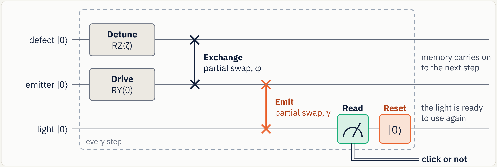

As a model it is a hidden quantum Markov model (Monras, Beige and Wiesner). Its step has two Kraus operators, K_0 and K_1, and P(y) = ||K_{y_T} ... K_{y_1} |0>||^2.

**Why condition at all?** Fitting to a recorded sequence, predicting the next click, and asking what follows a rare event are all conditional questions. On hardware, a generator answers them by rejection: keep the runs that match. That costs 1/p runs. Our own circuit diagrams note already flagged this as the wall.

## 2. Why Grover doesn't drop in

Our [research note](../README.md) gave three warnings, and each needed an answer.

| warning | answer |
|---|---|
| A reset can't be inverted | Purify: fresh lights, nothing measured until the end (section 3) |
| A hidden state isn't addressable memory | Search what the state really holds: its click histories, not stored records |
| A query speedup isn't a time speedup | Count machine calls and two-qubit gates throughout, and redesign around them (sections 6 to 9) |

## 3. Move 1: purify (E1)

By the deferred-measurement principle, swapping each reset for a fresh light can't change the click statistics. The pass marks were fixed before the run.

| check | result | pass mark |
|---|---|---|
| A\|0> against the Kraus branches, 0 to 2 defects, T up to 12 | largest amplitude error 4 × 10^-16 | 1e-12 |
| dynamic circuit against purified circuit on Aer, 1,000,000 shots each | chi-square p = 0.61 | above 0.001 |
| A then A-inverse | returns to the start with probability 1.000000000000 | |

## 4. Grover on the histories (E2)

One iteration is Q = A R₀ A† O. The oracle O flips the sign of matching histories, and for a click at one step it is a single Z gate. A† rewinds the machine, R₀ flips the sign of all zeros (X gates, a multi-controlled Z, X gates), and A replays it. So each iteration costs two machine calls.

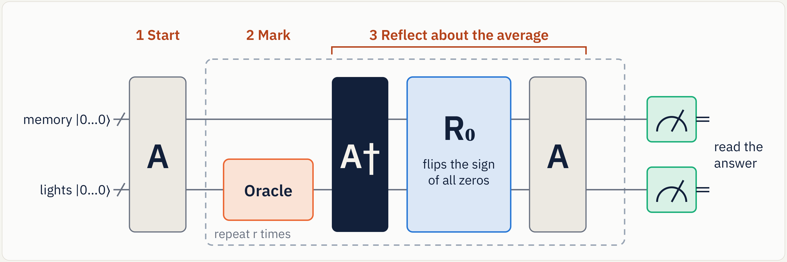

With Qiskit's `grover_operator`, A as the state preparation and a phase oracle on the click register, on six questions at T = 6:

| check | worst over all questions and iterations | pass mark |
|---|---|---|
| hit rate against sin^2((2r+1) theta) | 8 × 10^-15 | 1e-9 |
| distribution inside the marked set against P(y given marked) | 5 × 10^-15 | 1e-9 |
| hidden-qubit populations against the exact filter | 7 × 10^-15 | 1e-9 |

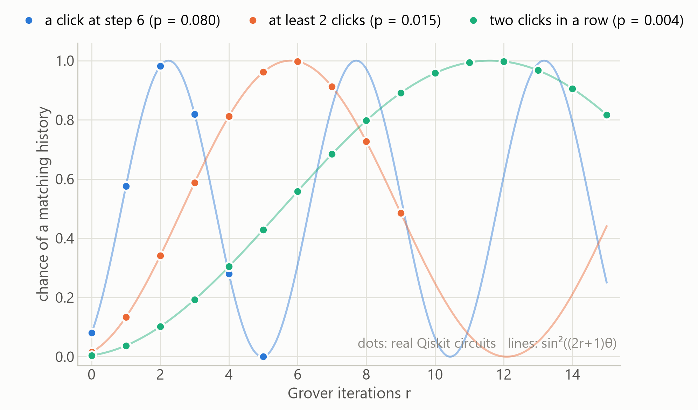

**Amplification reweights, and does not reshape.** Inside the marked set the relative amplitudes never change. So an amplified shot is an exact conditional sample, hidden memory included.

**Recurrent oracles.** A question read by a small automaton can be marked by a reversible reader that keeps a running count. That is a coherent QRSM in the oracle slot. For "at least 2 clicks", a lookup-table oracle takes 2^T - 2 two-qubit gates, while the reader's cost grows about linearly in T. It costs more up to about T = 10, and less after: 864 against 4,094 at T = 12. The tests check that it marks the same histories and leaves its counter clean.

## 5. Scaling, and the classical baseline (E3)

Exact simulation at T = 18, out to p = 3e-7:

| method | slope of log(calls) against log(p) | predicted |
|---|---|---|
| plain sampling | -1.000 | -1.00 |
| Grover, p known | -0.500 | -0.50 +- 0.02 |
| Grover, p unknown (BBHT) | -0.521 | -0.5 +- 0.1 |

Each iteration counts as two machine calls. With p unknown, BBHT costs a median of 2.0 times the known-p cost.

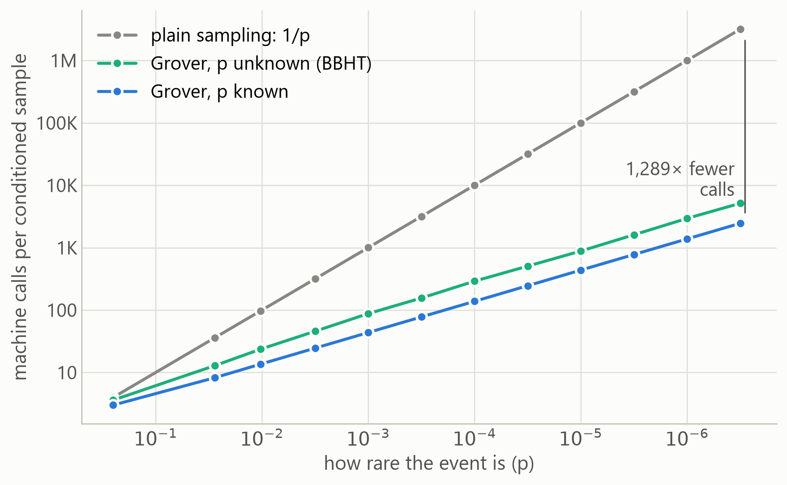

**The strongest classical baseline wins here.** A backward sampler uses an operator-valued message B[t][s], the sum over accepted futures of K-dagger K, to draw exact conditional samples with no rejection at all. It takes about a millisecond per sample at n = 2 hidden qubits. Its set-up time grew 5.7 times per hidden qubit at the largest sizes we ran (8 in theory), reaching 626 s at n = 11. Every quantum number in this report is beaten by this at this size. It matters only because it runs out.

## 6. Noise: what goes wrong

**Hit rate alone is a trap.** "Any click" at T = 3 scores 87.5% from pure noise, since 7 of 8 random bitstrings qualify. So every noisy result here also reports the conditional distribution's distance from the truth (TVD), and we use overshoot, the hit rate falling past the peak, as a coherence check that noise alone can't fake.

**Rare events hide under the noise floor.** At p = 0.00105, plain sampling on the FakeMarrakesh noise model reads 0.0029: 2.8 times too high, from false clicks.

**Textbook depth is expensive.** A 5-qubit multi-controlled Z costs 49 CZ on heavy-hex, or 27 with clean ancillas. Textbook Grover at T = 5 compiles to 456 CZ. At 0.2% error per gate, about 40% of those runs finish with no gate error.

## 7. Move 2: steer

A click's Kraus operator is K_1(gamma) = sin(alpha) |0><1| on the emitter, times the rest of the step. So the click operator at any emission strength is a constant multiple of the machine's own: K_1(gamma') = sqrt(gamma'/gamma) K_1(gamma). Changing the emission at step t therefore scales **every** history that clicks at t by the same constant. Conditional distributions and hidden states can't change, and p rises to p gamma'/gamma.

We found this by accident. Rewinding one step and watching one light gave TVD 0.000 and fidelity 1.000 at every T, with a boost of 4.8. An exact result from a crude cut needs an explanation, and that is it: K_1 has a single non-zero singular value, so amplifying it is perfectly uniform, and r iterations simply turn alpha into (2r + 1) alpha. No Grover is needed for that part.

So rarity has two factors: an **emission factor**, which a gate angle removes exactly, and a **population factor**, which is Grover's real job. This is the idea in section 07 of our research note: concentrate useful probability first, and use interference only for the rest.

**Tune p to 1/4 and one iteration gives certainty,** since sin^2(3 pi/6) = 1. At T = 5 to 14: hit 1.000, TVD 0, fidelity 1.000, in one iteration where textbook needs 2 or 3. At T = 3 and 4, full steering reaches p' = 0.20, and one iteration gives 0.965 and 0.972. It is forgiving: p' from 0.18 to 0.32 gives at least 0.94, so a rough estimate of p is enough.

**On a real record.** Over 4,096 held-out 64-step records of the hidden-defect machine, with a median of 5 clicks:

| build | calls per conditioned sample | two-qubit gates, as a scale estimate |
|---|---|---|
| plain sampling | 27,495,891 | |
| steering every clicked step | 6,240 | |
| Grover alone | 8,237 (r = 4,118) | about 2.7 million |
| steering, then Grover | 125 (r = 62) | about 40,000 |

**Credit where it's due.** Steering is classical importance sampling. It gives about 4,400 times, and Grover about 50 times on top. A fair baseline must include it, so this table does.

**Limits.** It is exact for clicks at known steps. "Any click" can't be steered exactly, because no-click steps have a non-uniform operator. And it relies on the physics-shaped model: a free-unitary QRSM has no such structure.

## 8. Move 3: amplify locally (E4, E4b)

The textbook reflection flips the sign of |0...0> over every qubit. We asked what happens if it looks at only some of them. One iteration of Q' = -A S' A-dagger S_f from A|0> gives exactly

    Q'|psi> = (1 - 4p)|psi> + 2|g> - 4 A|l>

where |g> is the marked part of |psi>, and the **leak** |l> is the part of the rewound marked state that the reflection can't see, with the |0> component removed. The tests check this formula. The leak predicts the damage: across 40 cells, its Spearman correlation with the share of the gain lost at r = 1 is 0.82.

**Memory only: our first idea, and its flaw.** Watching the 2 memory qubits costs 1 CZ, and it kept a median of 88% of the gain for single-event questions, with the worst TVD at 0.12. On noisy devices at r >= 2 it had a lower TVD than textbook in 100% of cells, and a higher hit rate in 73%. It lost the hit rate almost everywhere at r = 1 (it won 3%). For rare multi-click questions it fails: at p = 0.001 the peak is 0.28, not 1.

**Then E5 caught something hit rate could not.** Run past a click, the memory-only build gave conditional click rates of [0.091, 0.029, 0.009] where the truth is [0.018, 0.058, 0.101]. It keeps roughly the right histories and scrambles the hidden state they leave. Mean memory fidelity is only 0.70 to 0.89.

**The fix: watch the question's light too.** The biggest leak term is the light the question marks. With that watched, what's left needs an earlier click as well, so it is second order in the click rate. For "a click at step t" this is 3 qubits, whatever T is. Conditional click rates agree to 1e-4 at t = 3, and memory fidelity is at least 0.997 for T up to 4.

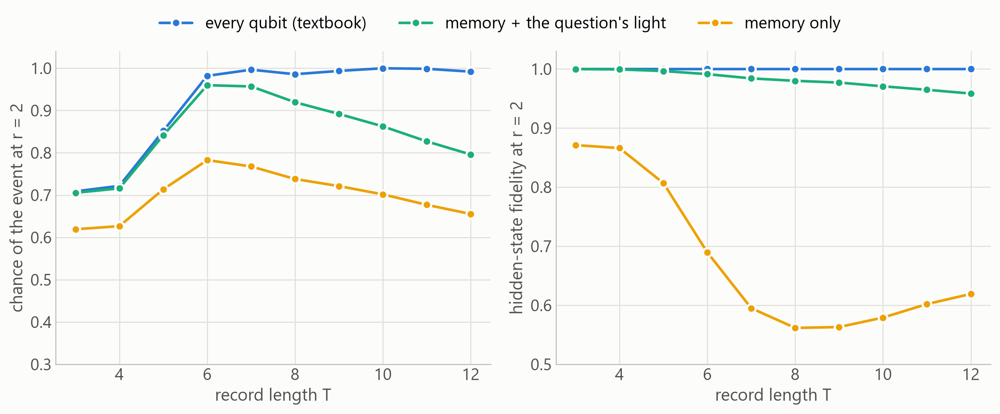

As predicted, it degrades on long records, where earlier clicks become likely. At T = 12 and r = 3 its TVD reaches 0.30. For long records, watching all the lights does better (hit 0.945 at T = 12, steered), but that gate grows with T.

**The saving exists only for local questions.** "Any click" reads every light, so its question-local reflection is the full one.

**On noisy devices,** against textbook at r >= 2 and T up to 5: a higher hit rate in 100% and a lower TVD in 100% of 32 cells, with 2.0 times fewer gates. Against memory only: a higher hit rate in 85% and a lower TVD in 38% of 40 cells.

## 9. The resilient build (E7)

Purify, steer to p' = 1/4, one iteration with the local reflection, and verify by measuring. On five IBM device snapshots, none of them the one the idea was developed on, compiled and scheduled for each device, 32,768 shots per cell:

| T | build | r | two-qubit gates | chance of the event | distribution error (TVD) |
|---|---|---|---|---|---|
| 3 | plain sampling | 0 | 13 | 0.05 (0.05 to 0.07) | 0.033 |
| 3 | textbook Grover | 3 | 213 | 0.76 (0.63 to 0.81) | 0.131 |
| 3 | local reflection | 3 | 112 | 0.84 (0.76 to 0.88) | 0.078 |
| 3 | steer + full reflection | 1 | 71 | 0.86 (0.80 to 0.90) | 0.054 |
| 3 | **steer + local** | 1 | 40 | 0.89 (0.85 to 0.92) | 0.060 |
| 4 | plain sampling | 0 | 20 | 0.06 (0.05 to 0.08) | 0.064 |
| 4 | textbook Grover | 3 | 329 | 0.72 (0.58 to 0.75) | 0.202 |
| 4 | local reflection | 3 | 161 | 0.82 (0.70 to 0.85) | 0.125 |
| 4 | steer + full reflection | 1 | 121 | 0.84 (0.75 to 0.87) | 0.104 |
| 4 | **steer + local** | 1 | 63 | 0.88 (0.82 to 0.91) | 0.103 |
| 5 | plain sampling | 0 | 27 | 0.07 (0.06 to 0.09) | 0.084 |
| 5 | textbook Grover | 3 | 456 | 0.68 (0.55 to 0.73) | 0.275 |
| 5 | local reflection | 3 | 210 | 0.82 (0.68 to 0.84) | 0.182 |
| 5 | steer + full reflection | 1 | 171 | 0.83 (0.70 to 0.86) | 0.144 |
| 5 | **steer + local** | 1 | 88 | 0.89 (0.80 to 0.91) | 0.147 |
| 6 | plain sampling | 0 | 34 | 0.09 (0.09 to 0.11) | 0.094 |
| 6 | textbook Grover | 2 | 376 | 0.69 (0.56 to 0.73) | 0.242 |
| 6 | local reflection | 2 | 184 | 0.80 (0.68 to 0.83) | 0.188 |
| 6 | steer + full reflection | 1 | 215 | 0.81 (0.66 to 0.84) | 0.183 |
| 6 | **steer + local** | 1 | 109 | 0.86 (0.76 to 0.88) | 0.166 |

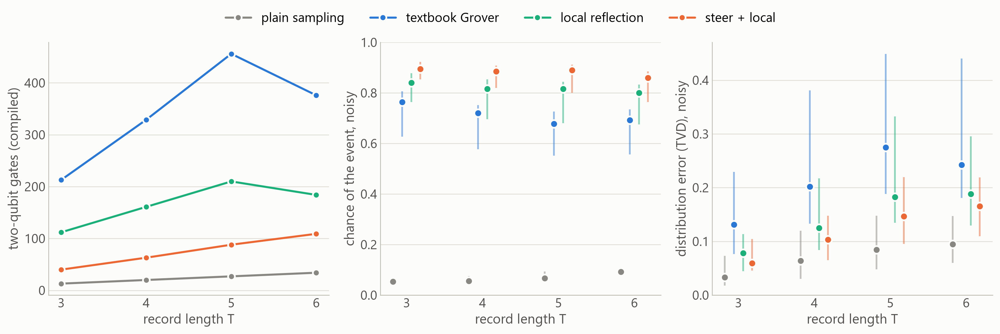

Against textbook, in 20 cells: a median of 5.2 times fewer two-qubit gates (range 2.9 to 5.3, the lowest at T = 6, where textbook needs only r = 2), a higher hit rate in 100%, and a lower TVD in 100%. Plain sampling has the lowest distortion of all, but keeps only 5 to 9% of its shots.

**A cheaper, slightly wrong circuit beats the exact one,** because the error it adds is smaller than the noise it avoids. On a much less noisy machine that stops being true, and textbook wins.

**What better hardware does.** The five snapshots span a 3-fold range of two-qubit error. At T = 5 the resilient build's lead in hit rate is 0.25 on the noisiest device and 0.19 on the best.

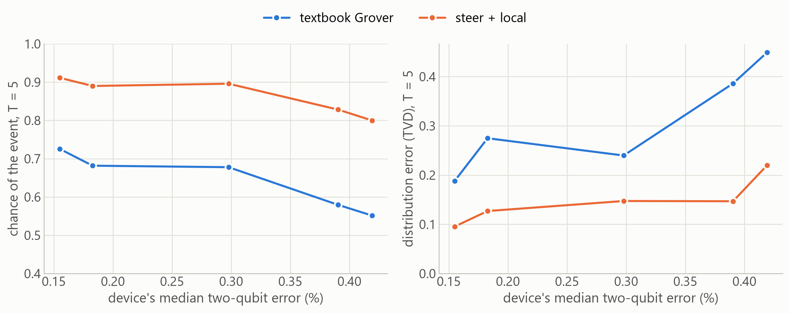

## 10. Grover inside the loop (E5)

Section 06 of our research note asks to insert retrieval at selected timesteps. So: amplify "a click at step t", then keep running on fresh lights. Each surviving shot is a sample of what the machine does after that event.

That query is physical. P(click at t + tau | click at t), divided by the plain rate, is the correlation g2(tau). A two-level emitter can't click twice at once, so g2 starts low. With no defect, a click wipes the machine, so the clicks that follow simply restart the run: the conditional rates are exactly the start-of-run rates. A hidden defect remembers across the click.

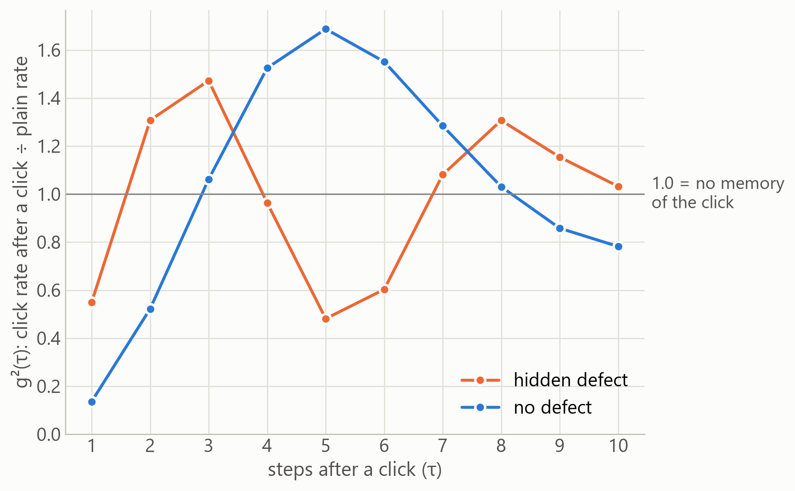

With the full reflection the circuit gives the filter's answer to 7 × 10^-17. On noisy devices at 4,096 shots (click at step 3, tau = 1 to 3):

| | plain sampling | steer + local, r = 1 |
|---|---|---|
| usable shots, one defect | 269 of 4,096 | 3,600 of 4,096 |
| RMSE of the click rates, one defect | 0.063 0.036 0.030 | 0.024 0.031 0.020 |
| RMSE of the click rates, no defect | 0.035 0.033 0.027 | 0.015 0.013 0.013 |
| separation of defect from no defect at tau = 3, in standard errors | **2.4** | **7.1** |

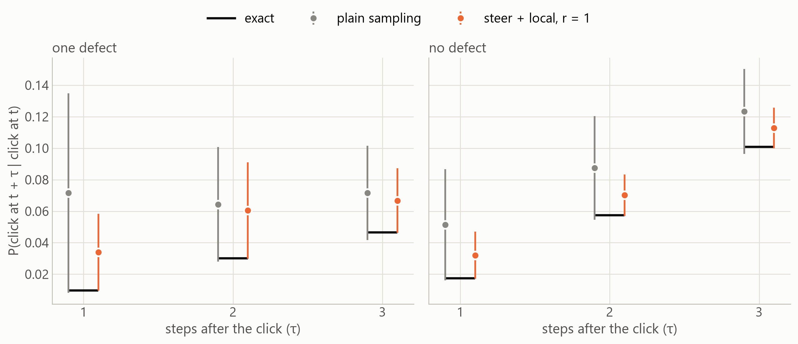

Both estimates are biased upward by false clicks, the amplified one less so. At tau = 1 the truth is below the noise floor for both, and the separation there is weak. This is the clearest case where the design pays today, in simulation: at equal shots it answers a question that plain sampling can't.

## 11. The other slot: a reader QRSM as the oracle (E6)

Amplitude amplification has two slots: what to search over, and what counts as a match. So far a QRSM has filled the first. Timofey's idea, retrieving data from a vague human search, fills the second.

1. **Classical.** A vague request becomes catalogue keywords, by stop words and a synonym table. A real system would use an embedding model here.
2. **Reader QRSM.** The index register holds every entry at once. Each token applies one diagonal step, which turns the phase of each entry containing it. This is the phase-layer QRSM from our circuit notes. It can't reset, and doesn't need to.
3. **Grover.** A full match reaches phase pi, a normal mark. A partial match gets a partial phase, and the first iteration multiplies its probability by about 5 - 4 cos(phase). So one circuit ranks partial matches, which is what makes a vague search possible.

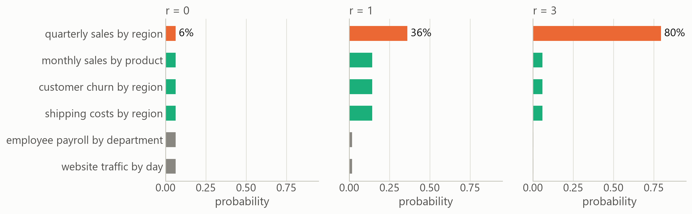

| measure | result |
|---|---|
| top-1 accuracy, 20 vague requests, 16 entries | 19 of 20, the same as the classical score. The one miss is the tokeniser, which maps "month" to "monthly" |
| ranked by score at r = 1 | 20 of 20 |
| median probability on the right entry | 0.89 |
| noisy, 8 entries, ideal 0.945 at r = 2 | 0.74 to 0.86 across five snapshots |

**There is no speedup, and the reason is structural.** The oracle is compiled from the catalogue, so classical code has already read every entry, and at N entries a diagonal costs up to N - 2 two-qubit gates:

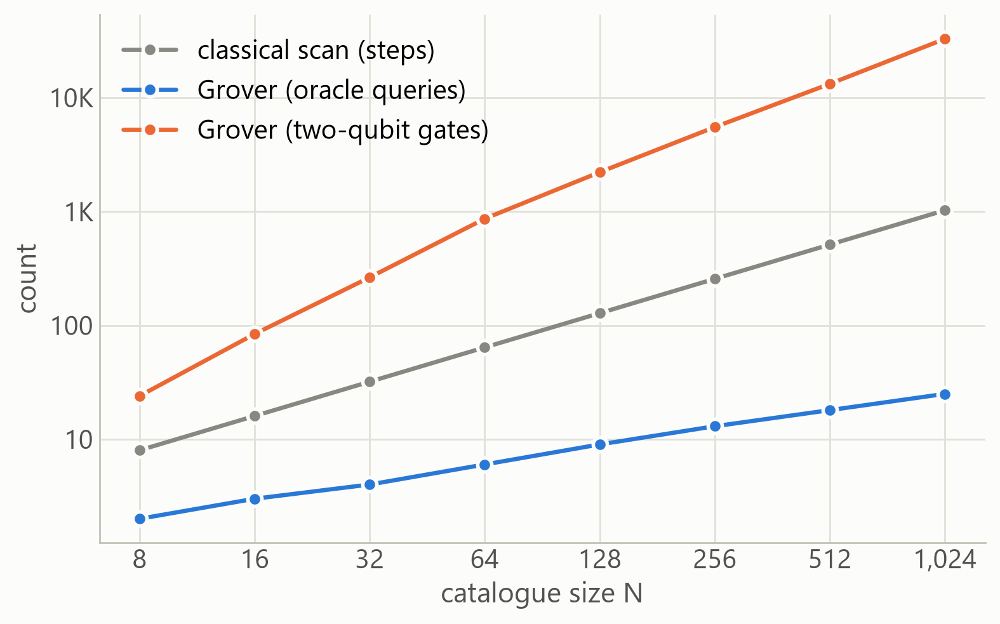

At 1,024 entries that is 32,800 gates against a 1,024-step scan. Grover's square root needs an oracle cheaper than reading the data.

## 12. Bounded rewinding (E7)

A hybrid QRSM forgets. So an iteration may only need to rewind the last w steps, not the whole history, which would make its cost independent of T. With the reflection on those w lights, at r = 2:

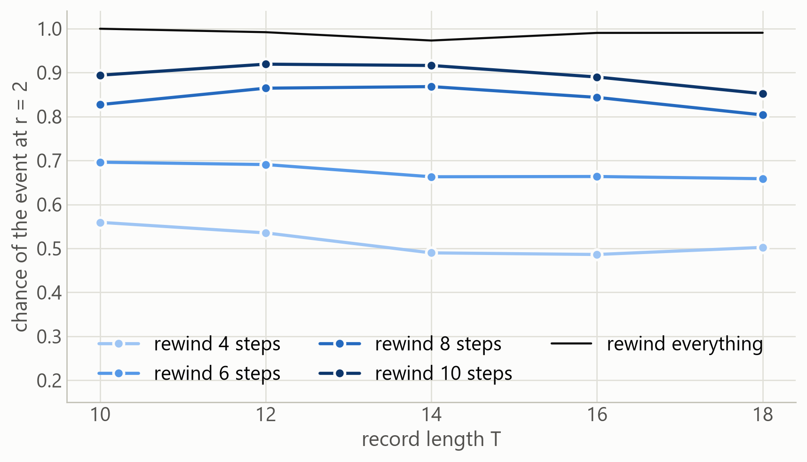

| rewind | hit rate, T = 10, 12, 14, 16, 18 | TVD | memory fidelity |
|---|---|---|---|
| 6 steps | 0.70, 0.69, 0.66, 0.66, 0.66 | 0.08 to 0.14 | 0.980 or better |
| 8 steps | 0.83, 0.86, 0.87, 0.84, 0.80 | 0.05 to 0.15 | 0.985 or better |
| 10 steps | 0.89, 0.92, 0.92, 0.89, 0.85 | 0.04 to 0.12 | 0.990 or better |

The hit rate stays roughly flat as T grows, and the hidden state stays good. But TVD grows, because history older than the horizon isn't reweighted. So this helps for questions about the recent past. We tested it noiselessly only.

## 13. Real hardware

**It ran.** On 5 November 2026 we ran the 39 circuits on two IBM Heron chips: seven jobs at 4,096 shots per circuit, 337 seconds of device time on the free plan. No circuit used more than 11 of a chip's 156 qubits. Before the first job, we committed our predictions, the code that scores them, the compiled circuits and a simulation of those circuits with the device's own noise model (commit `2059f36`). That model has gate errors, relaxation during gates and readout errors. It has no crosstalk and no decay on idle qubits. Hit rates here are readout-corrected.

We chose ibm_kingston on that day's calibration: median two-qubit error 0.18%, T1 261 µs, T2 163 µs.

### The resilient build won on Kingston

The first pair of jobs, one plain and one with DD + twirling:

| record | build | two-qubit gates | noiseless | noise model | real chip | real chip, DD + twirling | TVD, real chip | TVD, DD + twirling |
|---|---|---|---|---|---|---|---|---|
| T = 3 | plain sampling | 13 | 0.040 | 0.052 | 0.060 | 0.072 | 0.071 | 0.063 |
| T = 3 | textbook Grover, r = 3 | 213 | 0.972 | 0.763 | 0.589 | 0.620 | 0.263 | 0.240 |
| T = 3 | local reflection, r = 3 | 112 | 0.968 | 0.843 | 0.763 | 0.736 | 0.092 | 0.168 |
| T = 3 | steer + textbook reflection | 85 | 0.965 | 0.880 | 0.793 | 0.781 | 0.069 | 0.100 |
| T = 3 | **steer + local (resilient)** | 40 | 0.961 | 0.901 | **0.874** | 0.831 | **0.055** | 0.067 |
| T = 5 | plain sampling | 27 | 0.054 | 0.063 | 0.081 | 0.094 | 0.214 | 0.260 |
| T = 5 | local reflection, r = 3 | 210 | 0.986 | 0.804 | 0.650 | 0.663 | 0.327 | 0.390 |
| T = 5 | steer + textbook reflection | 171 | 1.000 | 0.815 | 0.645 | 0.612 | 0.428 | 0.352 |
| T = 5 | **steer + local (resilient)** | 88 | 0.989 | 0.882 | **0.750** | 0.781 | **0.160** | 0.200 |

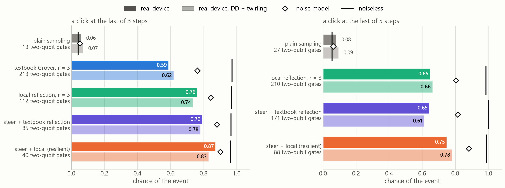

Across all five Kingston jobs, steer + local won 20 of 20 comparisons:

| | steer + local | its rival |
|---|---|---|
| T = 3, hit rate | 0.83 to 0.88, on 40 gates | 0.55 to 0.63, textbook r = 3, on 213 gates |
| T = 3, TVD | 0.06 to 0.08 | 0.21 to 0.30 |
| T = 5, hit rate | 0.75 to 0.79, on 88 gates | 0.61 to 0.68, the same steer with the textbook reflection, on 171 gates |
| T = 5, TVD | 0.14 to 0.21 | 0.28 to 0.43 |

The chip punished depth more than its noise model did, so the lead at T = 3 came out at 0.28 in the first job, against 0.14 predicted. Textbook Grover at its best, with DD, reached 0.63. That's still far behind steer + local with no suppression at all. Cutting gates mattered more than any suppression we tried.

### Every job, side by side

| job | IBM job ID | device seconds | T = 3: steer + local | T = 3: textbook | T = 5: steer + local | T = 5: same steer, textbook reflection | after-click separation at τ = 3 |
|---|---|---|---|---|---|---|---|
| Kingston, plain | `dbmfqlt8ft8s738uplmg` | 47 | 0.874 (TVD 0.055) | 0.589 (TVD 0.263) | 0.750 (TVD 0.160) | 0.645 (TVD 0.428) | +5.7 |
| Kingston, plain, repeat | `dbmfv758ft8s738upsdg` | 47 | 0.882 (TVD 0.057) | 0.551 (TVD 0.296) | 0.750 (TVD 0.143) | 0.647 (TVD 0.405) | +6.8 |
| Kingston, DD alone | `dbmfv7d8ft8s738upseg` | 47 | 0.843 (TVD 0.080) | 0.630 (TVD 0.206) | 0.788 (TVD 0.159) | 0.680 (TVD 0.277) | +0.1 |
| Kingston, twirling alone | `dbmfv7e74qds73ds7ojg` | 50 | 0.841 (TVD 0.073) | 0.568 (TVD 0.247) | 0.754 (TVD 0.210) | 0.611 (TVD 0.379) | +2.6 |
| Kingston, DD + twirling | `dbmfqme74qds73ds7ieg` | 50 | 0.831 (TVD 0.067) | 0.620 (TVD 0.240) | 0.781 (TVD 0.200) | 0.612 (TVD 0.352) | -1.0 |
| Marrakesh, plain | `dbmfvad8ft8s738upsjg` | 48 | 0.809 (TVD 0.360) | 0.372 (TVD 0.663) | 0.563 (TVD 0.512) | 0.581 (TVD 0.665) | +2.7 |
| Marrakesh, off the bad qubits | `dbmg49d8mdtc73d7tcn0` | 48 | 0.815 (TVD 0.115) | 0.513 (TVD 0.291) | 0.679 (TVD 0.207) | 0.536 (TVD 0.538) | +6.6 |

The last column is in standard errors, and it's positive when no defect sits above defect, as the exact answer has it.

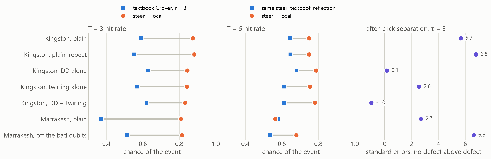

**It repeats.** A second plain job on the same compiled circuits gave 0.88 and 0.55, against 0.87 and 0.59 in the first.

### Noise analysis

**Interference survives.** With no defect, the hit rate should rise and then fall as r grows. Noise can't make that shape, because it pushes "any click" towards 0.875. The chip gave 0.21, 0.89, 0.72, 0.55, against 0.17, 0.92, 0.70, 0.02 noiseless. Falling well below 0.875 at r = 3 is interference, after 147 two-qubit gates.

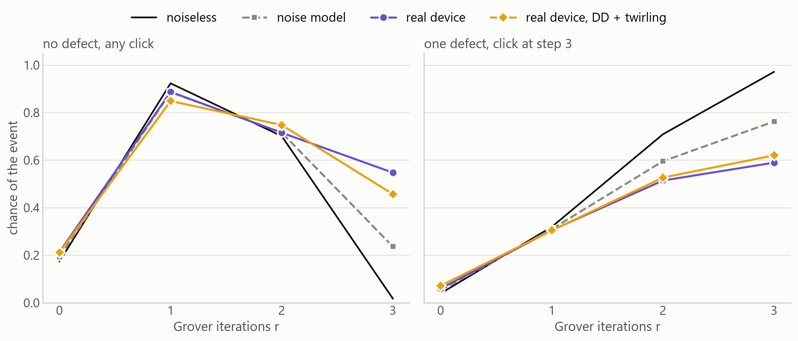

**Depth costs more than the model says.** Fidelity with the noiseless answer fell by about 0.45% per two-qubit gate, against 0.15% in the noise model. The echoes agree: run forwards and back, the all-in error came to 0.40% to 0.73% per gate on Kingston, against 0.22% to 0.25% in the model and 0.18% reported for the gate alone. The device fell below its model on 79% of circuits with an ideal hit rate of 0.5 or more. The model still ranked the circuits well, with a rank correlation of 0.95. So it's useful for comparing builds, and optimistic about how they'll do.

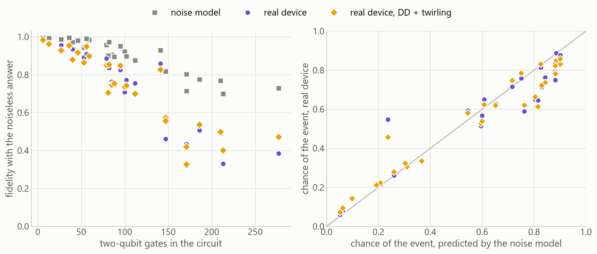

**Suppression did little.** Two identical plain jobs differ, circuit by circuit, about as much as a suppressed job differs from plain: the plain repeat "improved" TVD on 48% of circuits, and the three suppressed jobs on 45% to 48%. So those shares are run-to-run noise, and H5's 50% tells us nothing. What does show is small: median fidelity on circuits with 100 or more gates went from 0.50 to 0.53 to 0.55, and the slope of fidelity with depth eased from 0.45% to 0.35% to 0.42%. Against that, steer + local lost a little at T = 3, and DD erased the fingerprint.

**A bad patch on Marrakesh.** The first Marrakesh job went badly. At T = 3, steer + local got 0.81 (TVD 0.36) against 0.37 (TVD 0.66), where the model said TVD 0.05. At T = 5 it narrowly lost on hit rate: 0.56 (TVD 0.51) against 0.58 (TVD 0.66). Nearly all of the damage sat on one cluster of qubits, 5, 6, 7, 8 and 17. The compiler chose them for 31 of the 39 circuits, because the reported error rates made them look like the best on the chip. Echoes on them showed 1.5% to 3.4% per gate, against about 0.2% reported for those gates. Circuits that landed elsewhere on that chip did about as well as on Kingston.

So we recompiled to stay off those five qubits, and logged what we expected first. Echoes fell to 0.7% to 0.9%. Steer + local won all four comparisons: 0.82 (TVD 0.11) against 0.51 (TVD 0.29) at T = 3, and 0.68 (TVD 0.21) against 0.54 (TVD 0.54) at T = 5. We don't know what was wrong with those qubits. We picked them after seeing the data, so this job tests the explanation, and it isn't a clean replication. The practical lesson is cheap: run a short echo on a layout before trusting it.

### The fingerprint on real chips

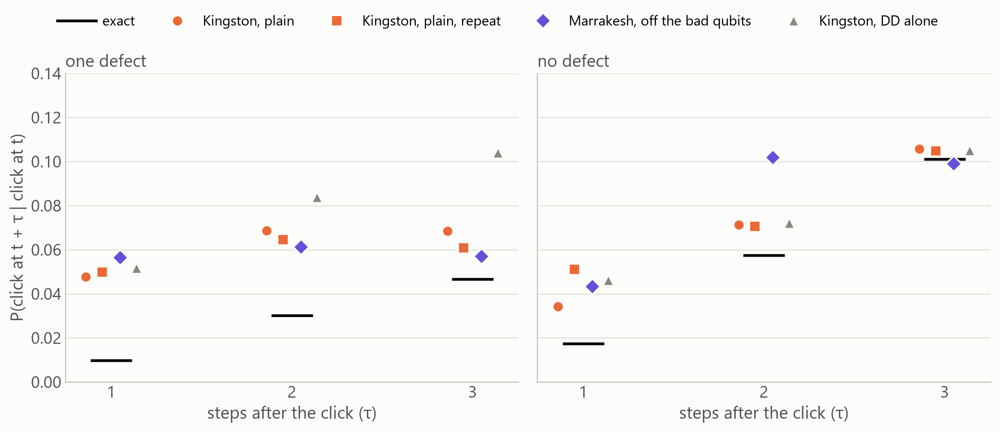

Telling a defect from none at τ = 3 means telling 0.047 from 0.101. With no suppression, steer + local read that difference at 5.7 and 6.8 standard errors on Kingston, and 6.6 on Marrakesh off the bad qubits. Plain sampling, from the same jobs, reached 0.0, 1.9, 0.6. That's close to the simulated 7.1 against 2.4.

It's fragile, though. DD took it to 0.1, twirling to 2.6, and both together to -1.0. We predicted twirling was to blame, and that missed. Every suppressed job raised the defect circuit's click rate at τ = 3, from about 0.065 to between 0.10 and 0.13. One possible reason, untested: fresh light qubits wait in |0>, where idling does them no harm, while DD keeps pulsing them. τ = 1 and τ = 2 don't separate reliably on either chip. And the two circuits differ in depth, with the deeper defect circuit getting more false clicks. That works against the separation, so it doesn't explain it away.

### What we predicted

These came before the jobs, and were scored by calculation: **12 held, 3 partly, 1 missed.** H6 scored "held" because it says "in either job", and the suppressed job on its own would not have passed. F6 and F7 test a post-hoc explanation.

| prediction | outcome | verdict |
|---|---|---|
| H1: T = 3: steer + local beats textbook r = 3 on hit rate and TVD, in both jobs | plain: hit 0.874 vs 0.589, TVD 0.055 vs 0.263; suppressed: hit 0.831 vs 0.620, TVD 0.067 vs 0.240 | held |
| H2: T = 3: steer + local reaches a hit rate of at least 0.75 in either job | best 0.874 | held |
| H3: No defect: hit rate at least 0.75 at r = 1, then back to 0.45 or less at r = 3, in either job | plain: 0.214 0.887 0.715 0.547; suppressed: 0.211 0.849 0.748 0.457 | partly |
| H4: The device falls short of its noise model: below it on at least 70% of circuits with ideal hit 0.5 or more, by a median of at least 0.02 | below on 79%, median shortfall 0.032 | held |
| H5: DD + twirling lowers TVD on at least 60% of circuits with 100 or more two-qubit gates | 50% of 12 | partly |
| H6: Defect against no defect at tau = 3: amplified separation at least 3 standard errors, and above plain sampling, in either job | plain: 5.7 vs 0.0; suppressed: 1.0 vs 1.2 | held |
| H7: Catalogue, r = 2: the right entry on top with a hit rate of at least 0.70 in either job | plain: 0.857; suppressed: 0.823 | held |
| H8: T = 5: steer + local reaches at least 0.60 and beats the same steer with the textbook reflection, in either job | plain: 0.750 vs 0.645; suppressed: 0.781 vs 0.612 | held |
| H9: Echo: the all-in error per two-qubit gate is above the reported median and at most 1%, on all three echoes | 0.52%, 0.64%, 0.40% against 0.18% reported | held |
| F1: A second plain run repeats both T = 3 hit rates to within 0.05 | resilient 0.874 then 0.882; textbook 0.589 then 0.551 | held |
| F2: The repeat again puts no defect above defect at tau = 3, by at least 3 standard errors | 6.8 standard errors, the right way round | held |
| F3: Twirling, not DD, is what erases the separation: DD alone keeps at least 3 standard errors, and twirling alone doesn't | DD alone 0.1, twirling alone 2.6 | missed |
| F4: A second chip: steer + local beats its rival on hit rate and TVD at T = 3 and T = 5, on ibm_marrakesh | T = 3: 0.809 vs 0.372, TVD 0.360 vs 0.663; T = 5: 0.563 vs 0.581, TVD 0.512 vs 0.665 | partly |
| F5: A second chip: steer + local reaches at least 0.70 at T = 3 | 0.809 | held |
| F6: Off qubits 5, 6, 7, 8 and 17, the echo's all-in error per two-qubit gate on ibm_marrakesh falls below 1%, from 1.5% to 3.4% | 0.92%, 0.79%, 0.73% | held |
| F7: Off those qubits, steer + local beats its rival on hit rate and TVD at T = 3 and T = 5, with TVD at T = 3 of 0.15 or less | T = 3: 0.815 vs 0.513, TVD 0.115 vs 0.291; T = 5: 0.679 vs 0.536, TVD 0.207 vs 0.538 | held |

## 14. What we predicted, and what happened

Expectations were logged before each run. The full list is in the [design log](design_log.md). The hardware predictions have their own table in section 13.

| prediction | outcome | verdict |
|---|---|---|
| Purified and dynamic circuits agree; amplitudes within 1e-12 | largest error 3.9e-16; chi-square p = 0.61 | held |
| Circuits follow Grover's curve and give exact conditionals, within 1e-9 | worst error 8e-15 | held |
| Slopes: -1.00 sampling, -0.50 ± 0.02 Grover, -0.5 ± 0.1 unknown p | -1.00, -0.50, -0.52 | held |
| Unknown p costs 2 to 6 times the known-p cost | median 2.0, range 1.2 to 2.1 | held |
| Median 64-step record costs 1e6 to 1e8 runs | 2.75e+07 | held |
| The classical sampler's set-up grows about 8 times per hidden qubit | 5.7 times at the largest sizes, with parallel linear algebra | partly |
| Memory reflection keeps at least 80% of the gain, with TVD below 0.1, for single-event questions at T up to 6 | median 88%, worst 63%; worst TVD 0.12 | partly |
| Memory reflection loses most of the gain on multi-click questions | best hit rate from 0.21 (rare, short) to about 1 (common, long): it depends on p | partly |
| The leak predicts the damage: Spearman at least 0.7 | 0.82 | held |
| Noisy, r ≥ 2: memory reflection wins hit rate in at least 80% of cells | 73% | missed |
| Noisy, r ≥ 2: memory reflection wins TVD in at least 80% of cells | 100% | held |
| Noisy, r = 1: hit rates split about evenly | memory reflection won 3% | missed |
| Local reflection beats textbook on hit rate and TVD in at least 80% of cells at r ≥ 2 | hit rate 100%, TVD 100%, in 32 cells | held |
| Local reflection has lower TVD than memory only in at least 60% of cells | 38%, in 40 cells | missed |
| Local reflection, noiseless: hit within 0.03 of exact for T up to 6, and TVD below 0.05 for T up to 8 | largest hit gap 0.022; largest TVD 0.31 | partly |
| Steer + full, r = 1: hit within 1e-9 of 1 wherever reachable, and TVD below 1e-9 | hit 1.000, TVD 0, at T = 5 to 14 | held |
| Steer + local uses at least 3 times fewer gates in every cell | 2.9 to 5.3 times | missed |
| Steer + local has a higher hit rate than textbook in at least 80% of cells | 100% | held |
| Steer + local has a lower TVD than textbook in at least 70% of cells | 100% | held |
| After a click, 4,096 shots: amplification has lower RMSE at tau = 2 and 3 on at least 4 of 5 snapshots | 4 of 5 with a defect, 5 of 5 without | held |
| Over a large shot budget plain sampling wins, because it has lower bias | its bias was larger: mean 0.035 against 0.019, because false clicks swamp a rare event | missed |
| The resilient lead shrinks on the best devices, but survives | at T = 5 the hit-rate lead is 0.25 on the noisiest device and 0.19 on the best | held |
| The keyword search's top result agrees with the classical score | 100% agreement | held |
| At a fixed rewind depth the hit rate stays within 0.05 as T grows | 4 steps: 0.073; 6 steps: 0.037; 8 steps: 0.064; 10 steps: 0.067 | partly |
| Steering a 64-step record gives 1e3 to 1e5 runs | 6,240 | held |

**Tally: 15 held, 5 partly, 5 missed.**

## 15. Limits

- **No speedup.** A classical sampler beats everything here at this size.
- **No quantum advantage shown.** A crossover at large hidden memories is plausible, and we can't test it.
- **Most results are simulation.** That includes the IBM noise models, which are snapshots. The real-chip runs are small: seven jobs on two chips in one evening, at most 11 qubits and 5 steps. At T = 5 the distribution error is still 0.14 to 0.21 on Kingston.
- **We rewind a model of a chip, never a chip.** A physical defect can't be run backwards. This queries what was learned from clicks.
- **Steering** is classical, exact only for clicks at known steps, and needs a rough p.
- **The local reflection** is an approximation, it drifts on long records, and it saves nothing for questions that read every light.
- **Bounded rewinding** is noiseless and distorts older history.
- **T qubits are the price of reversibility,** one per step.
- **Coverage.** One machine (theta 0.6, gamma 0.2, phi 0.45, zeta 0.3), one defect in most runs, five device snapshots, one seed per noisy cell.
- **We did not run** the research note's beat_20 benchmark, or any large-scale retrieval.

## 16. Why it could still matter, and what's next

A classical computer's cost grows exponentially with the hidden memory. A circuit's cost doesn't. IBM's [published target](https://www.ibm.com/quantum-computing/roadmap) for 2029 is 200 logical qubits and 100 million gates. As a rough estimate, a machine with 50 hidden qubits and a 150-step record fits in 200 logical qubits, while just holding that memory as a classical state vector takes about 18 petabytes. Conditioning on a 64-step record takes about 2.7 million gates as textbook Grover and about 40,000 once steered, so the design moves the job about 66 times closer to reach.

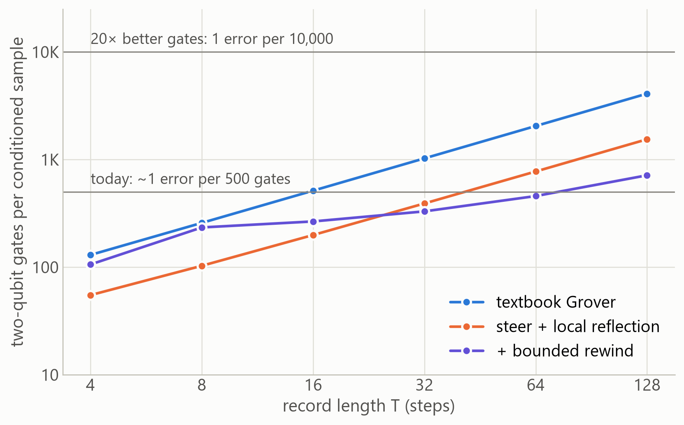

Next: run the hardware job; steering for learned models, where a click operator isn't uniform and steering becomes a training problem; error detection from what the machine conserves; rewinding set by the memory's own horizon; and testing the reader oracle on data with structure a compact oracle can use.

## References

See the [README](../README.md#references). The hidden-defect work this builds on is in [prior_work](../prior_work/hidden_defects/README.md).
